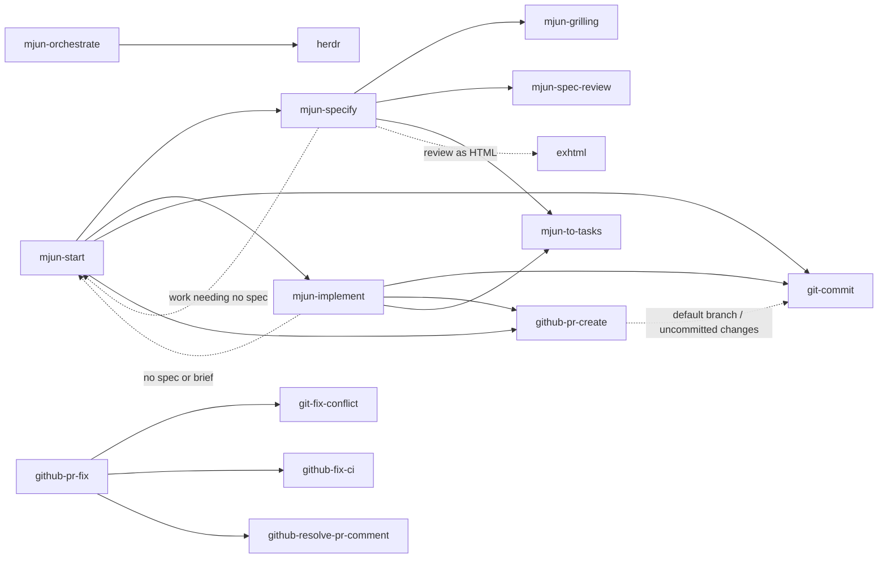

# Agent Skills

This document describes the AI agent skills used from this repository and how they depend on each other. Skills come from two sources.

Private skills (`mjun-*`) live under [`config/ai-agents/skills/`](../config/ai-agents/skills) and are deployed by `install.sh` as symlinks into:

- `~/.agents/skills/<skill>` — shared skills directory (Codex reads this directory directly)
- `~/.claude/skills/<skill>` — Claude Code
- `~/.gemini/antigravity-cli/skills/<skill>` — Antigravity CLI

Editing a file under `config/ai-agents/skills/` updates every agent at once via the symlink.

APM-managed skills and agents are declared in [`config/ai-agents/apm.yml`](../config/ai-agents/apm.yml), and `install.sh` runs `apm update -g -y` to deploy them. The inventory below follows the explicit selections in that manifest.

## APM-managed Primitives

APM deploys these packages to the `agent-skills`, `antigravity`, `claude`, and `codex` targets.

### Skills

| Package                                                                                                                           | Selected skills                                                                                                                                                                                                                                                                                                                                                                                                                                                                                 |
| --------------------------------------------------------------------------------------------------------------------------------- | ----------------------------------------------------------------------------------------------------------------------------------------------------------------------------------------------------------------------------------------------------------------------------------------------------------------------------------------------------------------------------------------------------------------------------------------------------------------------------------------------- |
| [`mjun0812/skills`](https://github.com/mjun0812/skills)                                                                           | `chat-note`, `claude`, `codex`, `cognitive-rhythm-writing`, `deep-research`, `doc-sync`, `duckdb`, `exhtml`, `exmd`, `experiment-plan`, `git-commit`, `git-fix-conflict`, `git-squash`, `github-fix-ci`, `github-issue-create`, `github-issue-update`, `github-pr-create`, `github-pr-fix`, `github-pr-review`, `github-resolve-pr-comment`, `japanese-tech-writing`, `resume-other-agent`, `self-review`, `skill-review`, `stop-ai-slop-jp`, `test-prune`, `wezterm-control`, `writing-skills` |
| [`vercel-labs/agent-browser`](https://github.com/vercel-labs/agent-browser)                                                       | [`agent-browser`](https://github.com/vercel-labs/agent-browser/blob/main/skills/agent-browser/SKILL.md)                                                                                                                                                                                                                                                                                                                                                                                         |
| [`remorses/playwriter/skills/playwriter`](https://github.com/remorses/playwriter/tree/main/skills/playwriter)                     | [`playwriter`](https://github.com/remorses/playwriter/blob/main/skills/playwriter/SKILL.md)                                                                                                                                                                                                                                                                                                                                                                                                     |
| [`herdrdev/herdr/skills/herdr`](https://github.com/herdrdev/herdr/tree/master/skills/herdr)                                       | [`herdr`](https://github.com/herdrdev/herdr/blob/master/skills/herdr/SKILL.md)                                                                                                                                                                                                                                                                                                                                                                                                                  |
| [`modem-dev/hunk/packages/hunk/skills/hunk-review`](https://github.com/modem-dev/hunk/tree/main/packages/hunk/skills/hunk-review) | [`hunk-review`](https://github.com/modem-dev/hunk/blob/main/packages/hunk/skills/hunk-review/SKILL.md)                                                                                                                                                                                                                                                                                                                                                                                          |
| [`github/gh-stack/skills/gh-stack`](https://github.com/github/gh-stack/tree/main/skills/gh-stack)                                 | [`gh-stack`](https://github.com/github/gh-stack/blob/main/skills/gh-stack/SKILL.md)                                                                                                                                                                                                                                                                                                                                                                                                             |
| [`jupyter-ai-contrib/nb-cli/skills/notebook-cli`](https://github.com/jupyter-ai-contrib/nb-cli/tree/main/skills/notebook-cli)     | [`notebook-cli`](https://github.com/jupyter-ai-contrib/nb-cli/blob/main/skills/notebook-cli/SKILL.md)                                                                                                                                                                                                                                                                                                                                                                                           |

### Agents

All four agents come from [`mjun0812/skills`](https://github.com/mjun0812/skills/tree/main/agents).

| Agent                                                                                                       | Purpose                                                                                                 |
| ----------------------------------------------------------------------------------------------------------- | ------------------------------------------------------------------------------------------------------- |
| [`code-reviewer-contract`](https://github.com/mjun0812/skills/blob/main/agents/code-reviewer-contract.md)   | Check a change only against the requirements, boundaries, and acceptance criteria in its spec contract. |
| [`code-reviewer-finder`](https://github.com/mjun0812/skills/blob/main/agents/code-reviewer-finder.md)       | Find actionable behavioral defects and regressions introduced or exposed by a change.                   |
| [`code-reviewer-standards`](https://github.com/mjun0812/skills/blob/main/agents/code-reviewer-standards.md) | Find mandatory repository-standard violations and code smells introduced by a change.                   |
| [`code-reviewer-verifier`](https://github.com/mjun0812/skills/blob/main/agents/code-reviewer-verifier.md)   | Try to refute one review candidate and return a confirmed, refuted, or uncertain verdict.               |

## Skill List

Each skill is a directory containing `SKILL.md`. The agent loads the front-matter `description` to decide when to use it. Each Purpose in the tables below is one or two sentences; the details live in the skill's `SKILL.md`.

### Development Flow (mjun)

The self-authored dev-flow skill suite under the `mjun-` prefix. Specs always live in `.mjun/specs/` as the source of truth, and GitHub issues act as import/projection adapters. The entry point is `mjun-start`, which routes work by kind (minor change, bug fix, refactoring, performance improvement, new feature) into flows of different weight. New features go through `mjun-specify` for an approved spec and task breakdown, and `mjun-implement` carries them through to a PR; bug fixes, refactorings, and performance work are implemented by `mjun-implement` from a brief that `mjun-start` writes under `.mjun/briefs/`. `mjun-orchestrate` is user-invoked only (`disable-model-invocation: true`), so the agent never picks it on its own; in Codex, `policy.allow_implicit_invocation: false` in `agents/openai.yaml` limits it to an explicit `$mjun-orchestrate`. Every skill reads the glossary `CONTEXT.md` and ADRs, one per file (`NNNN-<slug>.md`), which outlive the disposable specs and briefs. Each repository keeps them either in Git (root `CONTEXT.md`, `docs/adr/`) or locally (`.mjun/CONTEXT.md`, `.mjun/steering/adr/`); the human is asked once, right before the first one is written, and the location of that first file decides from then on. Done specs are never looked up again and are deleted by hand. Only decisions that are hard to reverse, surprising without context, and the result of a real trade-off become ADRs; agents write them automatically in a minimal form (a title and 1-3 sentences). Decisions that stay within a spec (including tentative ones) live in that spec's `design.md` under `## Decisions`, and approval and implementation checks inspect tentative ones there. ADRs are not copied on delivery. To move records into Git, transfer the glossary to root `CONTEXT.md` and every ADR file to `docs/adr/` (renumbering only those that collide with existing ADRs); verify tracking, contents and references, then delete the original files under `.mjun/`. Read and write only the destination afterward.

| Skill                                                                      | Purpose                                                                                                                                                                                                                                                                                                                                               |
| -------------------------------------------------------------------------- | ----------------------------------------------------------------------------------------------------------------------------------------------------------------------------------------------------------------------------------------------------------------------------------------------------------------------------------------------------- |
| [`mjun-start`](../config/ai-agents/skills/mjun-start/SKILL.md)             | Entry point for dev work: route each request to a minor change, bug fix, refactoring, performance improvement, or new feature, and run a flow of matching weight. Minor changes are made in place, bug fixes, refactorings, and performance work go to `mjun-implement` through a brief under `.mjun/briefs/`, and new features go to `mjun-specify`. |
| [`mjun-specify`](../config/ai-agents/skills/mjun-specify/SKILL.md)         | Polish an idea, GitHub issue, or Markdown into a spec that an implementer can start without further research. The agent settles what investigation can decide, asks the human only for the rest, and writes the spec under `.mjun/specs/` after approval on a one-screen decision sheet.                                                              |
| [`mjun-grilling`](../config/ai-agents/skills/mjun-grilling/SKILL.md)       | Resolve the open decisions in a plan, design, or spec by asking the user in rounds, each question with a recommended answer. It covers the whole design, or only the decisions a calling skill hands over.                                                                                                                                            |
| [`mjun-spec-review`](../config/ai-agents/skills/mjun-spec-review/SKILL.md) | Adversarially review a spec against its source, steering, ADRs, the glossary, other active specs, and existing code, and return only the findings a verifier confirmed. A finding must rest on evidence outside the spec, and the skill never edits files.                                                                                            |
| [`mjun-to-tasks`](../config/ai-agents/skills/mjun-to-tasks/SKILL.md)       | Break a spec into independently verifiable vertical-slice tasks and save them to `tasks.md`, splitting a task only when it exceeds one implementer's context (24 acceptance criteria). Its bundled `check_spec_format.sh` checks the format of the spec files and is also run by `mjun-specify` and `mjun-implement`.                                 |
| [`mjun-implement`](../config/ai-agents/skills/mjun-implement/SKILL.md)     | Implement an approved spec, or a brief from `mjun-start`, task group by task group in a worktree with implementer and reviewer subagents, then verify the acceptance criteria. It commits and delivers the work as a PR or a fast-forward merge (`--merge`).                                                                                          |
| [`mjun-orchestrate`](../config/ai-agents/skills/mjun-orchestrate/SKILL.md) | Switch the calling session into an orchestration mode that drives several worker agents in Herdr panes on the human's behalf, sending each the request a human would type and answering their questions. It runs only when the user invokes it and keeps the plan and progress in `.mjun/orchestrate/<run>/board.md`.                                 |
| [`mjun-steering`](../config/ai-agents/skills/mjun-steering/SKILL.md)       | Create and update the project memory under `.mjun/steering/`, the glossary `CONTEXT.md`, and ADRs from the codebase and its history (merged PRs, closed issues, docs). Sync reports where the memory has drifted from the code.                                                                                                                       |
| [`mjun-rule-lint`](../config/ai-agents/skills/mjun-rule-lint/SKILL.md)     | Turn written code conventions (CLAUDE.md, steering, ADRs, repeated review comments) into local ast-grep rules and scripts under `.mjun/lint/`, without touching the repository's linter settings, git hooks, or CI. `mjun-implement` and `mjun-start` run these lints only on files changed in the current work.                                      |

### Git

| Skill                                                                                                   | Purpose                                                                                                                                                                         |
| ------------------------------------------------------------------------------------------------------- | ------------------------------------------------------------------------------------------------------------------------------------------------------------------------------- |
| [`git-commit`](https://github.com/mjun0812/skills/blob/main/skills/git/git-commit/SKILL.md)             | Stage and commit the current changes in appropriate units                                                                                                                       |
| [`git-squash`](https://github.com/mjun0812/skills/blob/main/skills/git/git-squash/SKILL.md)             | Squash / tidy commits on the current branch, force-with-lease push if needed                                                                                                    |
| [`git-fix-conflict`](https://github.com/mjun0812/skills/blob/main/skills/git/git-fix-conflict/SKILL.md) | Detect and resolve conflicts from merge, rebase, cherry-pick, revert, apply, PR, etc.                                                                                           |
| [`self-review`](https://github.com/mjun0812/skills/blob/main/skills/review/self-review/SKILL.md)        | Adversarially review uncommitted changes or one specified commit with two independent Finders and a Standards reviewer (`--spec` adds a contract axis checked against the spec) |

### GitHub

| Skill                                                                                                                        | Purpose                                                                                                                                                                                                             |
| ---------------------------------------------------------------------------------------------------------------------------- | ------------------------------------------------------------------------------------------------------------------------------------------------------------------------------------------------------------------- |
| [`github-issue-create`](https://github.com/mjun0812/skills/blob/main/skills/github/github-issue-create/SKILL.md)             | Create one GitHub issue from a todo, memo, or bug note after verifying its claims (repo, then official docs when needed) and searching related issues (template and label auto-selection, approval before creation) |
| [`github-issue-update`](https://github.com/mjun0812/skills/blob/main/skills/github/github-issue-update/SKILL.md)             | Inspect open issues and propose closes (resolved, duplicate, stale), comments, and label changes, then apply them in bulk after approval                                                                            |
| [`github-pr-create`](https://github.com/mjun0812/skills/blob/main/skills/github/github-pr-create/SKILL.md)                   | Create a Pull Request from the current branch with a six-part description covering overview and background, related issues, implementation approach, changes, impact, and validation results                        |
| [`github-pr-review`](https://github.com/mjun0812/skills/blob/main/skills/github/github-pr-review/SKILL.md)                   | Find merge-blocking issues, standards findings, and spec mismatches (when a spec resolves via `--spec` or a linked issue) with parallel reviewers, verify each candidate, and replace the previous review snapshot  |
| [`github-pr-fix`](https://github.com/mjun0812/skills/blob/main/skills/github/github-pr-fix/SKILL.md)                         | Detect and fix all PR problems (conflicts, CI failures, review comments) inside a dedicated worktree                                                                                                                |
| [`github-fix-ci`](https://github.com/mjun0812/skills/blob/main/skills/github/github-fix-ci/SKILL.md)                         | Inspect CI status, analyze failures, and apply fixes                                                                                                                                                                |
| [`github-resolve-pr-comment`](https://github.com/mjun0812/skills/blob/main/skills/github/github-resolve-pr-comment/SKILL.md) | Triage PR review comments and respond / address them                                                                                                                                                                |

### Planning & Design

| Skill                                                                                                      | Purpose                                                                                                                |
| ---------------------------------------------------------------------------------------------------------- | ---------------------------------------------------------------------------------------------------------------------- |
| [`experiment-plan`](https://github.com/mjun0812/skills/blob/main/skills/planning/experiment-plan/SKILL.md) | Interview the user one decision at a time and save a testable machine-learning experiment plan to `.mjun/experiments/` |

### Docs & Notes

| Skill                                                                                                  | Purpose                                                                                                                                                                                            |
| ------------------------------------------------------------------------------------------------------ | -------------------------------------------------------------------------------------------------------------------------------------------------------------------------------------------------- |
| [`doc-sync`](https://github.com/mjun0812/skills/blob/main/skills/docs/doc-sync/SKILL.md)               | Diff repo docs (Markdown, docstrings, OpenAPI, config samples) against the implementation and update drift                                                                                         |
| [`chat-note`](https://github.com/mjun0812/skills/blob/main/skills/docs/chat-note/SKILL.md)             | Write the current conversation's research and discussion out as a single Japanese Markdown file, without adding outside information                                                                |
| [`deep-research`](https://github.com/mjun0812/skills/blob/main/skills/research/deep-research/SKILL.md) | Deep-research a given topic by combining prior knowledge with thorough web search, and produce a cited Markdown research memo                                                                      |
| [`exhtml`](https://github.com/mjun0812/skills/blob/main/skills/docs/exhtml/SKILL.md)                   | Explain a concept, mechanism, or research result as a single self-contained HTML page with glossary, table of contents, diagrams, and code, filled from the bundled template                       |
| [`exmd`](https://github.com/mjun0812/skills/blob/main/skills/docs/exmd/SKILL.md)                       | Explain a concept, mechanism, or research result as a single GFM Markdown page with a term table, table of contents, Mermaid diagrams, and code; researches topics not covered in the conversation |

### Japanese Writing

| Skill                                                                                                                       | Purpose                                                                                                                                                |
| --------------------------------------------------------------------------------------------------------------------------- | ------------------------------------------------------------------------------------------------------------------------------------------------------ |
| [`cognitive-rhythm-writing`](https://github.com/mjun0812/skills/blob/main/skills/writing/cognitive-rhythm-writing/SKILL.md) | Design rhythm in Japanese explanatory prose through shifts in cognitive mode, sentence pacing, and paragraph density; diagnose and revise flat writing |
| [`japanese-tech-writing`](https://github.com/mjun0812/skills/blob/main/skills/writing/japanese-tech-writing/SKILL.md)       | Style guide for writing and revising Japanese technical prose (formatting, paragraph-driven argument, removing LLM-flavored filler)                    |
| [`stop-ai-slop-jp`](https://github.com/mjun0812/skills/blob/main/skills/writing/stop-ai-slop-jp/SKILL.md)                   | Edit AI-generated Japanese back into human-written prose — fixes missing authorial stance, propositional H2s, false-balance, monotone rhythm           |

Sources:

- `japanese-tech-writing` — based on [k16shikano/fd287c3133457c4fd8f5601d34aa817d](https://gist.github.com/k16shikano/fd287c3133457c4fd8f5601d34aa817d)

### Cross-Agent Consultation & Delegation

These skills are user-invoked only — the agent does not trigger them on its own.

Each skill defaults to a read-only consultation mode, and runs with edit permissions only when the user explicitly asks to delegate work. An agent never uses the skill for its own CLI.

| Skill                                                                                      | Purpose                                                                                   |
| ------------------------------------------------------------------------------------------ | ----------------------------------------------------------------------------------------- |
| [`claude`](https://github.com/mjun0812/skills/blob/main/skills/delegation/claude/SKILL.md) | Consult Claude Code (`claude -p`, read-only) or delegate work to it with edit permissions |
| [`codex`](https://github.com/mjun0812/skills/blob/main/skills/delegation/codex/SKILL.md)   | Consult Codex (`codex exec`, read-only sandbox) or delegate work via `workspace-write`    |

### Misc

| Skill                                                                                                              | Purpose                                                                                                                                                                                                                                                                              |
| ------------------------------------------------------------------------------------------------------------------ | ------------------------------------------------------------------------------------------------------------------------------------------------------------------------------------------------------------------------------------------------------------------------------------ |
| [`resume-other-agent`](https://github.com/mjun0812/skills/blob/main/skills/delegation/resume-other-agent/SKILL.md) | Resume another coding agent (Codex / Claude Code) by session ID, replaying its prior context                                                                                                                                                                                         |
| [`skill-review`](https://github.com/mjun0812/skills/blob/main/skills/agent-skill/skill-review/SKILL.md)            | Validate Agent Skills compliance and report per-criterion verdicts, including trigger conflicts with nearby skills and leftovers of superseded criteria; after a review, proposes rules that emerged from the fixes and, on approval, appends them to its own criteria and CHANGELOG |
| [`test-prune`](https://github.com/mjun0812/skills/blob/main/skills/review/test-prune/SKILL.md)                     | Review every test in the codebase and list the ones that can be deleted or merged, judged by which realistic defects would go unnoticed without them                                                                                                                                 |
| [`wezterm-control`](https://github.com/mjun0812/skills/blob/main/skills/tools/wezterm-control/SKILL.md)            | Drive wezterm panes / tabs / windows via `wezterm cli`: split, focus, resize, read pane contents, send commands and verify their output                                                                                                                                              |
| [`writing-skills`](https://github.com/mjun0812/skills/blob/main/skills/agent-skill/writing-skills/SKILL.md)        | Create or edit a skill test-first: run a pressure scenario with a subagent before the skill exists, write the skill against the observed failures, and rerun until the subagent complies. Adapted from obra/superpowers with its test-driven-development background bundled          |

## Dependencies

The following skills invoke other skills through the agent's `Skill` tool. Arrows point from caller to callee.

### Caller → callee table

| Caller             | Callee                                                             | When                                                                                                                                                                                                                                                       |
| ------------------ | ------------------------------------------------------------------ | ---------------------------------------------------------------------------------------------------------------------------------------------------------------------------------------------------------------------------------------------------------- |
| `github-pr-create` | `git-commit`                                                       | Phase 0 only, when the current branch is the default branch or has uncommitted changes                                                                                                                                                                     |
| `mjun-start`       | `mjun-specify`, `mjun-implement`, `git-commit`, `github-pr-create` | New features and wide refactorings go to mjun-specify; bug fixes, refactorings, and performance work go to mjun-implement with a brief. Minor changes are made in place, committed with git-commit, and opened as a PR with github-pr-create when chosen   |
| `mjun-specify`     | `mjun-start`                                                       | When Phase 0 finds work that needs no spec (minor change, bug fix, refactoring, performance improvement)                                                                                                                                                   |
| `mjun-specify`     | `mjun-grilling`                                                    | When human-owned decisions need resolving, or tentative decisions remain before the spec review (evidence-blocked ones are researched by the skill itself)                                                                                                 |
| `mjun-specify`     | `mjun-spec-review`                                                 | Phase 4 (before approval) compares the spec with the source, ADRs, other active specs, and existing code, and applies only valid findings; skipped for specs with one module, no human-owned decisions, and no change to a persisted data format           |
| `mjun-specify`     | `mjun-to-tasks`                                                    | Drafts the task plan with `--draft` before approval (for the task count on the approval sheet and to fix uncovered spec gaps), then finalizes tasks.md from that draft after approval (including single-task specs; an existing tasks.md is re-decomposed) |
| `mjun-specify`     | `exhtml`                                                           | Phase 5 when the human picks "review as HTML" (a diagrammed design explainer); without the skill, written ad hoc                                                                                                                                           |
| `mjun-specify`     | `github-issue-create`                                              | Phase 7 when a spec without `Source:` gets a projection-target issue: the skill picks the template and labels, searches related issues, and confirms before creating; the judgment sheet and acceptance criteria are then projected below the marker line  |
| `mjun-implement`   | `github-issue-create`                                              | Phase 5 files the follow-ups the human picks (out-of-scope items meant for later and out-of-range concerns) one issue at a time                                                                                                                            |
| `mjun-implement`   | `git-commit`, `github-pr-create`, `mjun-to-tasks`, `mjun-start`    | Phase 4 commits the worktree changes; PR only with `--pr`. Re-decomposes tasks.md when tasks prove oversized or mis-split. Requests with no spec, brief, or design doc (including issue numbers without a spec) go to mjun-start                           |
| `mjun-orchestrate` | `herdr`                                                            | Read first for Herdr CLI syntax, IDs, and lifecycle states; the skill adds only the worker protocol on top                                                                                                                                                 |
| `github-pr-fix`    | `git-fix-conflict`, `github-fix-ci`, `github-resolve-pr-comment`   | Each callee runs only if the corresponding problem is detected                                                                                                                                                                                             |

### Standalone skills

These skills do not delegate to other skills:

`chat-note`, `claude`, `codex`, `cognitive-rhythm-writing`, `deep-research`, `doc-sync`, `exhtml`, `exmd`, `experiment-plan`, `git-commit`, `git-fix-conflict`, `git-squash`, `github-fix-ci`, `github-issue-create`, `github-issue-update`, `github-pr-review`, `github-resolve-pr-comment`, `japanese-tech-writing`, `mjun-grilling`, `mjun-spec-review`, `mjun-steering`, `mjun-to-tasks`, `resume-other-agent`, `self-review`, `skill-review`, `stop-ai-slop-jp`, `test-prune`, `wezterm-control`, `writing-skills`.

## Conventions

- Skill names use kebab-case and are scoped by domain (`git-*`, `github-*`, plus a few generic ones).
- Front matter (`name`, `description`, `allowed-tools`) is the contract the agent reads — keep `description` rich enough to trigger correctly, and list `Skill(<dep>)` in `allowed-tools` for any sub-skill the body invokes.
- Client-specific fields such as `allowed-tools` may be ignored by unsupported agents. When present, follow the target client's current syntax and grant only the tools and command scopes the skill requires.
- When extending an existing skill's behavior, prefer calling the original skill via the `Skill` tool rather than duplicating its logic, so all agents pick up improvements in one place.
