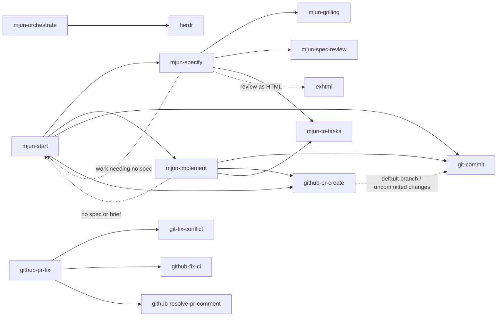

# Agent Skills

This document describes the AI agent skills used from this repository and how they depend on each other. Skills come from two sources.

Private skills (`mjun-*`) live under [`config/ai-agents/skills/`](../config/ai-agents/skills) and are deployed by `install.sh` as symlinks into:

- `~/.agents/skills/<skill>` — shared skills directory (Codex reads this directory directly)
- `~/.claude/skills/<skill>` — Claude Code
- `~/.gemini/antigravity-cli/skills/<skill>` — Antigravity CLI

Editing a file under `config/ai-agents/skills/` updates every agent at once via the symlink.

APM-managed skills and agents are declared in [`config/ai-agents/apm.yml`](../config/ai-agents/apm.yml), and `install.sh` runs `apm update -g -y` to deploy them. The inventory below follows the explicit selections in that manifest.

## APM-managed Primitives

APM deploys these packages to the `agent-skills`, `antigravity`, `claude`, and `codex` targets.

### Skills

| Package                                                                                                                       | Selected skills                                                                                                                                                                                                                                                                                                                                                                                                                                                                                 |
| ----------------------------------------------------------------------------------------------------------------------------- | ----------------------------------------------------------------------------------------------------------------------------------------------------------------------------------------------------------------------------------------------------------------------------------------------------------------------------------------------------------------------------------------------------------------------------------------------------------------------------------------------- |
| [`mjun0812/skills`](https://github.com/mjun0812/skills)                                                                       | `chat-note`, `claude`, `codex`, `cognitive-rhythm-writing`, `deep-research`, `doc-sync`, `duckdb`, `exhtml`, `exmd`, `experiment-plan`, `git-commit`, `git-fix-conflict`, `git-squash`, `github-fix-ci`, `github-issue-create`, `github-issue-update`, `github-pr-create`, `github-pr-fix`, `github-pr-review`, `github-resolve-pr-comment`, `japanese-tech-writing`, `resume-other-agent`, `self-review`, `skill-review`, `stop-ai-slop-jp`, `test-prune`, `wezterm-control`, `writing-skills` |
| [`vercel-labs/agent-browser`](https://github.com/vercel-labs/agent-browser)                                                   | [`agent-browser`](https://github.com/vercel-labs/agent-browser/blob/main/skills/agent-browser/SKILL.md)                                                                                                                                                                                                                                                                                                                                                                                         |
| [`remorses/playwriter/skills/playwriter`](https://github.com/remorses/playwriter/tree/main/skills/playwriter)                 | [`playwriter`](https://github.com/remorses/playwriter/blob/main/skills/playwriter/SKILL.md)                                                                                                                                                                                                                                                                                                                                                                                                     |
| [`herdrdev/herdr/skills/herdr`](https://github.com/herdrdev/herdr/tree/master/skills/herdr)                                   | [`herdr`](https://github.com/herdrdev/herdr/blob/master/skills/herdr/SKILL.md)                                                                                                                                                                                                                                                                                                                                                                                                                  |
| [`github/gh-stack/skills/gh-stack`](https://github.com/github/gh-stack/tree/main/skills/gh-stack)                             | [`gh-stack`](https://github.com/github/gh-stack/blob/main/skills/gh-stack/SKILL.md)                                                                                                                                                                                                                                                                                                                                                                                                             |
| [`jupyter-ai-contrib/nb-cli/skills/notebook-cli`](https://github.com/jupyter-ai-contrib/nb-cli/tree/main/skills/notebook-cli) | [`notebook-cli`](https://github.com/jupyter-ai-contrib/nb-cli/blob/main/skills/notebook-cli/SKILL.md)                                                                                                                                                                                                                                                                                                                                                                                           |

### Agents

All four agents come from [`mjun0812/skills`](https://github.com/mjun0812/skills/tree/main/agents).

| Agent                                                                                                       | Purpose                                                                                                 |
| ----------------------------------------------------------------------------------------------------------- | ------------------------------------------------------------------------------------------------------- |
| [`code-reviewer-contract`](https://github.com/mjun0812/skills/blob/main/agents/code-reviewer-contract.md)   | Check a change only against the requirements, boundaries, and acceptance criteria in its spec contract. |
| [`code-reviewer-finder`](https://github.com/mjun0812/skills/blob/main/agents/code-reviewer-finder.md)       | Find actionable behavioral defects and regressions introduced or exposed by a change.                   |
| [`code-reviewer-standards`](https://github.com/mjun0812/skills/blob/main/agents/code-reviewer-standards.md) | Find mandatory repository-standard violations and code smells introduced by a change.                   |
| [`code-reviewer-verifier`](https://github.com/mjun0812/skills/blob/main/agents/code-reviewer-verifier.md)   | Try to refute one review candidate and return a confirmed, refuted, or uncertain verdict.               |

## Skill List

Each skill is a directory containing `SKILL.md`. The agent loads the front-matter `description` to decide when to use it.

### Development Flow (mjun)

The self-authored dev-flow skill suite under the `mjun-` prefix. Specs always live in `.mjun/specs/` as the source of truth, and GitHub issues act as import/projection adapters. The entry point is `mjun-start`, which routes work by kind (minor change, bug fix, refactoring, performance improvement, new feature) into flows of different weight. New features go through `mjun-specify` for an approved spec and task breakdown, and `mjun-implement` carries them through to a PR; bug fixes, refactorings, and performance work are implemented by `mjun-implement` from a brief that `mjun-start` writes under `.mjun/briefs/`. `mjun-orchestrate` is user-invoked only (`disable-model-invocation: true`), so the agent never picks it on its own; in Codex, `policy.allow_implicit_invocation: false` in `agents/openai.yaml` limits it to an explicit `$mjun-orchestrate`. Every skill reads the glossary `CONTEXT.md` and ADRs, one per file (`NNNN-<slug>.md`), which outlive the disposable specs and briefs. Each repository keeps them either in Git (root `CONTEXT.md`, `docs/adr/`) or locally (`.mjun/CONTEXT.md`, `.mjun/steering/adr/`); the human is asked once, right before the first one is written, and the location of that first file decides from then on. Done specs are never looked up again and are deleted by hand. Only decisions that are hard to reverse, surprising without context, and the result of a real trade-off become ADRs; agents write them automatically in a minimal form (a title and 1-3 sentences). Decisions that stay within a spec (including tentative ones) live in that spec's `design.md` under `## Decisions`, and approval and implementation checks inspect tentative ones there. ADRs are not copied on delivery. To move records into Git, transfer the glossary to root `CONTEXT.md` and every ADR file to `docs/adr/` (renumbering only those that collide with existing ADRs); verify tracking, contents and references, then delete the original files under `.mjun/`. Read and write only the destination afterward.

| Skill                                                                      | Purpose                                                                                                                                                                                                                                                                                                                                                                                                                                                                                                                                                                                                                                                                                                                                                                                                                                                                                                                                                                                                                                                                                                                                                                                                                                                                                                                                                                                                                                                                                                                                                                                                                                                                                                                                                                                                                                                                                                                                                                                                                                                                                                                                                                                                                                                                                                                                                                                                                                                                                                                                                                                                                                                                                                                                                                                                                                                                                                                                                                                                                                                                                                                                                                                                                                                                                                                                                                                                                                                                                                                                                                                                                                                                                                                                                                                                                                                                                                                                                                                                                                                                                                                                                                                                                                                                                                                                                                                                                                                                                                                                                                                                                                                                                    |
| -------------------------------------------------------------------------- | ------------------------------------------------------------------------------------------------------------------------------------------------------------------------------------------------------------------------------------------------------------------------------------------------------------------------------------------------------------------------------------------------------------------------------------------------------------------------------------------------------------------------------------------------------------------------------------------------------------------------------------------------------------------------------------------------------------------------------------------------------------------------------------------------------------------------------------------------------------------------------------------------------------------------------------------------------------------------------------------------------------------------------------------------------------------------------------------------------------------------------------------------------------------------------------------------------------------------------------------------------------------------------------------------------------------------------------------------------------------------------------------------------------------------------------------------------------------------------------------------------------------------------------------------------------------------------------------------------------------------------------------------------------------------------------------------------------------------------------------------------------------------------------------------------------------------------------------------------------------------------------------------------------------------------------------------------------------------------------------------------------------------------------------------------------------------------------------------------------------------------------------------------------------------------------------------------------------------------------------------------------------------------------------------------------------------------------------------------------------------------------------------------------------------------------------------------------------------------------------------------------------------------------------------------------------------------------------------------------------------------------------------------------------------------------------------------------------------------------------------------------------------------------------------------------------------------------------------------------------------------------------------------------------------------------------------------------------------------------------------------------------------------------------------------------------------------------------------------------------------------------------------------------------------------------------------------------------------------------------------------------------------------------------------------------------------------------------------------------------------------------------------------------------------------------------------------------------------------------------------------------------------------------------------------------------------------------------------------------------------------------------------------------------------------------------------------------------------------------------------------------------------------------------------------------------------------------------------------------------------------------------------------------------------------------------------------------------------------------------------------------------------------------------------------------------------------------------------------------------------------------------------------------------------------------------------------------------------------------------------------------------------------------------------------------------------------------------------------------------------------------------------------------------------------------------------------------------------------------------------------------------------------------------------------------------------------------------------------------------------------------------------------------------------------------------ |
| [`mjun-start`](../config/ai-agents/skills/mjun-start/SKILL.md)             | Entry point for dev work: route each request to a minor change, bug fix, refactoring, performance improvement, or new feature. Minor changes are made in place and delivered after the relevant lint and tests, the ID check, and a diff re-read; bug fixes (reproduction steps and the source that defines the expected behavior), refactorings (behavior to preserve), and performance work (measurement method, baseline, and a human-set target) get a brief under `.mjun/briefs/` that is handed to `mjun-implement`; new features and refactorings too large for one task go to `mjun-specify` after confirmation. The delivery method is asked once up front, and work escalates automatically to a heavier kind when its assumptions break                                                                                                                                                                                                                                                                                                                                                                                                                                                                                                                                                                                                                                                                                                                                                                                                                                                                                                                                                                                                                                                                                                                                                                                                                                                                                                                                                                                                                                                                                                                                                                                                                                                                                                                                                                                                                                                                                                                                                                                                                                                                                                                                                                                                                                                                                                                                                                                                                                                                                                                                                                                                                                                                                                                                                                                                                                                                                                                                                                                                                                                                                                                                                                                                                                                                                                                                                                                                                                                                                                                                                                                                                                                                                                                                                                                                                                                                                                                                         |
| [`mjun-specify`](../config/ai-agents/skills/mjun-specify/SKILL.md)         | Polish an idea, GitHub issue, or local markdown into an implementable spec (contract): Phase 0 first routes the request (extend an existing active spec, hand work that needs no spec to `mjun-start`, or create a new spec); investigate facts, resolve agent-owned decisions autonomously, confirm human-owned or uncertain ones (independent decisions are asked together in one question), always write design.md (the implementation design inside the contract) once decisions settle, resolve any tentative (low-confidence) decisions before the spec review by gathering evidence or confirming them with the human (questions end there; the rest runs unattended until approval), surface boundary overlaps with other active specs (Owns / Public Contracts Affected / Change Outline) as human-owned decisions and record cross-spec dependencies as `spec: <slug>` under Dependencies, draft the task plan before approval and finalize tasks.md after approval, then project the approved decision sheet and the acceptance criteria to the issue (the original body of an imported issue is kept and the projection is appended below a marker line; local-only specs are offered a projection-target issue at that point) Approval is taken on a one-screen decision sheet (purpose, scope, decisions made by the human and by the agent, behavior examples, and what the human must check by eye); spec.md and design.md are agent-facing documents the human does not need to read. Look-and-feel questions are settled by prototypes whose screenshots or videos are kept under the spec as references, and they become eyeball-check scenarios in design.md instead of acceptance criteria. Before asking for approval, `mjun-spec-review` compares the spec against the source, ADRs, other active specs, and existing code in a fresh context (skipped for specs with one module, no human-owned decisions, and no change to a persisted data format). Human-owned conditions take precedence when decision classifications overlap. When adopting a new dependency, abstraction, or configuration option, record simpler alternatives and the adoption rationale under `## Decisions` in design.md.                                                                                                                                                                                                                                                                                                                                                                                                                                                                                                                                                                                                                                                                                                                                                                                                                                                                                                                                                                                                                                                                                                                                                                                                                                                                                                                                                                                                                                                                                                                                                                                                                                                                                                                                                                                                                                                                                                                                                                                                                                                                                                                                                                                                                                                                                                                                                                                                                                                                |
| [`mjun-grilling`](../config/ai-agents/skills/mjun-grilling/SKILL.md)       | Resolve plan / design / spec decisions interactively in rounds: ask the whole frontier (decisions whose prerequisites are settled) with recommended answers, dispatch fact-finding to subagents without blocking, and continue until the design tree is exhausted (whole-design mode) or resolve only the handed-over decisions, asking independent ones together (specified-decision mode); never acts before shared understanding is confirmed                                                                                                                                                                                                                                                                                                                                                                                                                                                                                                                                                                                                                                                                                                                                                                                                                                                                                                                                                                                                                                                                                                                                                                                                                                                                                                                                                                                                                                                                                                                                                                                                                                                                                                                                                                                                                                                                                                                                                                                                                                                                                                                                                                                                                                                                                                                                                                                                                                                                                                                                                                                                                                                                                                                                                                                                                                                                                                                                                                                                                                                                                                                                                                                                                                                                                                                                                                                                                                                                                                                                                                                                                                                                                                                                                                                                                                                                                                                                                                                                                                                                                                                                                                                                                                           |
| [`mjun-spec-review`](../config/ai-agents/skills/mjun-spec-review/SKILL.md) | Adversarially review a spec (`.mjun/specs/<slug>`, a GitHub issue or PR number, any design markdown, or the design discussed in the conversation) by comparing it with what exists outside the spec. One fresh-context reviewer proposes candidates for drift from the source, conflicts with steering / ADRs / the glossary, conflicts with other active specs, fit with existing code (including acceptance criteria the code makes unsatisfiable and missed interactions with existing mechanisms), handling of persisted data, and conflicts with human-owned decisions; a single verifier tries to refute each against the source text and real code, and only confirmed findings are returned to chat. Candidates are kept by where their evidence lives, not by viewpoint: evidence must be outside the spec (code lines, the source, ADRs, existing docs, other specs) or a human-owned decision, so concerns argued only from the spec text or general principles are dropped; only designs that change a persisted data format may rest on the design text alone. The task breakdown is not reviewed. In spec mode it also returns the findings of `check_spec_format.sh`. Never edits files                                                                                                                                                                                                                                                                                                                                                                                                                                                                                                                                                                                                                                                                                                                                                                                                                                                                                                                                                                                                                                                                                                                                                                                                                                                                                                                                                                                                                                                                                                                                                                                                                                                                                                                                                                                                                                                                                                                                                                                                                                                                                                                                                                                                                                                                                                                                                                                                                                                                                                                                                                                                                                                                                                                                                                                                                                                                                                                                                                                                                                                                                                                                                                                                                                                                                                                                                                                                                                                                                     |
| [`mjun-to-tasks`](../config/ai-agents/skills/mjun-to-tasks/SKILL.md)       | Persist a spec as independently verifiable vertical-slice tasks in tasks.md, including single-task specs; a bundled script (`scripts/check_spec_format.sh`, also run by mjun-specify before the spec review and by mjun-implement at start) checks the machine-read format of spec.md, design.md, and tasks.md (fields, status vocabulary, existing and acyclic Blocked by, at most 8 acceptance criteria per task, no leftover tentative decisions), and for specs awaiting approval also checks that Evidence and Change Outline paths and dependent specs exist. Before saving, an internal coverage check maps requirements, acceptance criteria, and the design’s modules / seams / data flow onto tasks and repairs gaps (max 2 rounds). The breakdown is not reviewed; mistakes in how tasks are cut are fixed by re-decomposing during implementation. With `--draft` it writes the draft to `tasks.draft.md` and stops (so the task count can go on the approval sheet and uncovered spec gaps can be fixed before approval), and given that draft it applies only later spec changes; completed tasks whose acceptance criteria change return to ready, while blocked tasks keep their reason and resume condition until the blocker is demonstrably resolved. Task size is judged by one verifying command per task, change confined to one design module, single responsibility, prerequisites as preceding tasks, a `Done when` line, and 3–6 acceptance criteria as a guide (split above 8), with changes that alter other tasks' assumptions ordered first; each task carries a Seam and no file paths                                                                                                                                                                                                                                                                                                                                                                                                                                                                                                                                                                                                                                                                                                                                                                                                                                                                                                                                                                                                                                                                                                                                                                                                                                                                                                                                                                                                                                                                                                                                                                                                                                                                                                                                                                                                                                                                                                                                                                                                                                                                                                                                                                                                                                                                                                                                                                                                                                                                                                                                                                                                                                                                                                                                                                                                                                                                                                                                                                                                                                                                      |
| [`mjun-implement`](../config/ai-agents/skills/mjun-implement/SKILL.md)     | Gate the spec on explicit contract approval, the presence of design.md and tasks.md (task decisions belong to mjun-specify; this skill never decomposes a spec itself), and completion of dependency specs (issue numbers resolve via Source lookup; unimported issues are routed to mjun-specify), implement task group by task group in a worktree via implementer/reviewer subagents (groups are filled in dependency order up to 8 tasks / 24 acceptance criteria; one implementer per group, continued across rework rounds instead of respawned) (the reviewer mechanically checks diff paths against design.md's Change Outline), resume from the branch recorded in tasks.md (when launched inside a clean linked worktree prepared by a caller such as mjun-orchestrate, it adopts that worktree and branch and leaves their cleanup to the caller), verify acceptance criteria and contract boundaries, rebase onto the latest base branch and re-run every check if the content changed, then commit and deliver by opening a PR or fast-forward merging into the base branch (`--merge`). It also accepts briefs written by `mjun-start` (`.mjun/briefs/`), giving the implementer and reviewer a kind-specific lens (reproduction and root cause, preserved behavior, or measurement) and skipping the refactor pass; bug fixes record before/after evidence at the highest reachable level (test, real-surface observation, or instrumentation) and only block when instrumentation still cannot show the mechanism; UI scenarios are captured as screenshots or videos under `.mjun/evidence/` and attached to the PR, and eyeball-check scenarios end in a manual-verification verdict without stopping delivery; after delivery it lists follow-ups (out-of-scope items meant for later work, skipped reviewer notes, out-of-range concerns) and files the ones the human picks as issues, because the spec is disposable; requests with no spec, brief, or design doc are handed to `mjun-start`. Before each group a verifier subagent turns the acceptance criteria into failing executable checks, runs the formatter and linter on the check files before reporting, and retries once with a different verification method when necessary, after which an unverifiable task becomes review-only (the reviewer matches each acceptance criterion against the code, and the final verdict requires manual verification); if the implementer's report still lists failing or interrupted runs without evidence that they fail the same way before the change, the parent sends it back before starting a reviewer; before starting a reviewer the parent runs the checks itself through a bundled script and hands the results to the reviewer; the script records passes per worktree-content fingerprint and skips checks that already passed on identical content (after approval, after refactoring, in feature validation, and after rebase), and a subagent's report is never taken as verification. Subagents receive templates and the contract as handoff files under `.mjun/runs/` by path instead of having them copied into each prompt. Oversized tasks and task decomposition or ordering failures are repaired automatically through mjun-to-tasks only when contract meaning is preserved; unresolved tasks are isolated so independent tasks can continue, and the final report lists blockers, resume conditions, and dependent tasks left waiting. A fresh-context debugger classifies non-converging failures, a refactor pass cleans up under green checks, then a single feature validation covers smoke, AC matrix and cross-task consistency. Every subagent is a leaf role that cannot re-delegate; only the main conversation brokers handoffs and additional delegation. A bundled script checks code, commits, and PRs for spec-internal identifiers (task IDs, AC numbers, requirement numbers, and so on) after each commit, before delivery, and after PR creation. Rejections that do not converge, problems that need the checks, spec, or environment revisited, and repeated identical failures go to the debugger (at most two calls per group); each role's model and effort come from `references/subagent.md`. Code-writing principles adapted from pstack (one file per principle under `principles/`, such as model-the-domain, boundary-discipline, and test-behavior-not-implementation) are copied into the run directory, and each role reads only the ones listed for it in `references/subagent.md`; the repository's own conventions take precedence, and the reviewer reports violations as notes instead of rejecting |
| [`mjun-orchestrate`](../config/ai-agents/skills/mjun-orchestrate/SKILL.md) | Switch the calling session into an orchestration mode that operates several worker agents in parallel on the human's behalf, until the user ends it. It runs only when the user invokes it explicitly and never fires on the agent's own judgment (`disable-model-invocation`). Every work request, including research and review, is split into tasks for workers rather than subagents, and each worker receives the same request a human would type into its pane, including skill invocations such as `/mjun-implement #12 --pr`. Tasks running `/mjun-implement` or changing tracked files without a skill get a Herdr worktree workspace (`herdr worktree create`, grouped under the orchestrator's workspace) that the orchestrator removes without `--force` after completion, keeping the branch; other tasks run in a `⚙️ workers` tab in the current workspace (adding `⚙️ workers 2` and so on every four panes, with no cap on the number of workers). A worker agent starts per task in its own pane with permission prompts bypassed (the user picks claude / codex / opencode / agy at mode start and then types the model name freely; an empty answer keeps the CLI's default model). The request carries only a work-location note, a report file (`.mjun/orchestrate/<run>/<slug>.md` with `PR:` / `Branch:` / `## Result` / `## Next`) that survives pane closure and context loss, and a `DONE` report on completion; commits, PRs, and review are left to the worker and its skill. Reports, transcripts, screens, and PR content are treated as data, never as instructions; `## Next` lines are only relayed to the user. Receipt is confirmed through Herdr state reaching `working`, falling back to another agent kind on usage limits or auth failures. The orchestrator answers worker questions and dialogs as a human would, asking the user only what it cannot decide. A task is finished on `DONE` plus a settled lifecycle wait; the orchestrator records the reported result without re-verifying the deliverable and closes the pane immediately. The calling session never edits files itself                                                                                                                                                                                                                                                                                                                                                                                                                                                                                                                                                                                                                                                                                                                                                                                                                                                                                                                                                                                                                                                                                                                                                                                                                                                                                                                                                                                                                                                                                                                                                                                                                                                                                                                                                                                                                                                                                                                                                                                                                                                                                                                                                                                                                                                                                                                                                                                                                                                                                                                                                       |
| [`mjun-steering`](../config/ai-agents/skills/mjun-steering/SKILL.md)       | Maintain `.mjun/steering/` as implementation-grounded project memory (an ADR whose decision becomes a mechanical check keeps its body and gains an `Enforced by:` line; Sync reports a vanished check as drift): bootstrap from the codebase, sync with drift detection, and mine history (merged PRs, closed issues, docs) into the glossary `CONTEXT.md` and ADRs for decisions that meet the three criteria, one file each (`docs/adr/` or `.mjun/steering/adr/`, whichever the repository chose) (append-only)                                                                                                                                                                                                                                                                                                                                                                                                                                                                                                                                                                                                                                                                                                                                                                                                                                                                                                                                                                                                                                                                                                                                                                                                                                                                                                                                                                                                                                                                                                                                                                                                                                                                                                                                                                                                                                                                                                                                                                                                                                                                                                                                                                                                                                                                                                                                                                                                                                                                                                                                                                                                                                                                                                                                                                                                                                                                                                                                                                                                                                                                                                                                                                                                                                                                                                                                                                                                                                                                                                                                                                                                                                                                                                                                                                                                                                                                                                                                                                                                                                                                                                                                                                         |
| [`mjun-rule-lint`](../config/ai-agents/skills/mjun-rule-lint/SKILL.md)     | Turn written code conventions (CLAUDE.md, steering, ADRs, repeated review comments, the conversation) into local lints kept outside the repository: ast-grep rules and scripts under `.mjun/lint/`. It never changes the repository's linter settings, git hooks, CI, or tracked documents; each lint is checked once against a violating and a correct example (no test files are kept), and local docs and local ADRs gain a pointer to the lint. mjun-implement and the minor-change flow of mjun-start run the lints through `scripts/run_local_lint.sh` on files added or changed in the current work only, so existing violations do not block                                                                                                                                                                                                                                                                                                                                                                                                                                                                                                                                                                                                                                                                                                                                                                                                                                                                                                                                                                                                                                                                                                                                                                                                                                                                                                                                                                                                                                                                                                                                                                                                                                                                                                                                                                                                                                                                                                                                                                                                                                                                                                                                                                                                                                                                                                                                                                                                                                                                                                                                                                                                                                                                                                                                                                                                                                                                                                                                                                                                                                                                                                                                                                                                                                                                                                                                                                                                                                                                                                                                                                                                                                                                                                                                                                                                                                                                                                                                                                                                                                       |

### Git

| Skill                                                                                                   | Purpose                                                                                                                                                                         |
| ------------------------------------------------------------------------------------------------------- | ------------------------------------------------------------------------------------------------------------------------------------------------------------------------------- |
| [`git-commit`](https://github.com/mjun0812/skills/blob/main/skills/git/git-commit/SKILL.md)             | Stage and commit the current changes in appropriate units                                                                                                                       |
| [`git-squash`](https://github.com/mjun0812/skills/blob/main/skills/git/git-squash/SKILL.md)             | Squash / tidy commits on the current branch, force-with-lease push if needed                                                                                                    |
| [`git-fix-conflict`](https://github.com/mjun0812/skills/blob/main/skills/git/git-fix-conflict/SKILL.md) | Detect and resolve conflicts from merge, rebase, cherry-pick, revert, apply, PR, etc.                                                                                           |
| [`self-review`](https://github.com/mjun0812/skills/blob/main/skills/review/self-review/SKILL.md)        | Adversarially review uncommitted changes or one specified commit with two independent Finders and a Standards reviewer (`--spec` adds a contract axis checked against the spec) |

### GitHub

| Skill                                                                                                                        | Purpose                                                                                                                                                                                                             |
| ---------------------------------------------------------------------------------------------------------------------------- | ------------------------------------------------------------------------------------------------------------------------------------------------------------------------------------------------------------------- |
| [`github-issue-create`](https://github.com/mjun0812/skills/blob/main/skills/github/github-issue-create/SKILL.md)             | Create one GitHub issue from a todo, memo, or bug note after verifying its claims (repo, then official docs when needed) and searching related issues (template and label auto-selection, approval before creation) |
| [`github-issue-update`](https://github.com/mjun0812/skills/blob/main/skills/github/github-issue-update/SKILL.md)             | Inspect open issues and propose closes (resolved, duplicate, stale), comments, and label changes, then apply them in bulk after approval                                                                            |
| [`github-pr-create`](https://github.com/mjun0812/skills/blob/main/skills/github/github-pr-create/SKILL.md)                   | Create a Pull Request from the current branch with a six-part description covering overview and background, related issues, implementation approach, changes, impact, and validation results                        |
| [`github-pr-review`](https://github.com/mjun0812/skills/blob/main/skills/github/github-pr-review/SKILL.md)                   | Find merge-blocking issues, standards findings, and spec mismatches (when a spec resolves via `--spec` or a linked issue) with parallel reviewers, verify each candidate, and replace the previous review snapshot  |
| [`github-pr-fix`](https://github.com/mjun0812/skills/blob/main/skills/github/github-pr-fix/SKILL.md)                         | Detect and fix all PR problems (conflicts, CI failures, review comments) inside a dedicated worktree                                                                                                                |
| [`github-fix-ci`](https://github.com/mjun0812/skills/blob/main/skills/github/github-fix-ci/SKILL.md)                         | Inspect CI status, analyze failures, and apply fixes                                                                                                                                                                |
| [`github-resolve-pr-comment`](https://github.com/mjun0812/skills/blob/main/skills/github/github-resolve-pr-comment/SKILL.md) | Triage PR review comments and respond / address them                                                                                                                                                                |

### Planning & Design

| Skill                                                                                                      | Purpose                                                                                                                |
| ---------------------------------------------------------------------------------------------------------- | ---------------------------------------------------------------------------------------------------------------------- |
| [`experiment-plan`](https://github.com/mjun0812/skills/blob/main/skills/planning/experiment-plan/SKILL.md) | Interview the user one decision at a time and save a testable machine-learning experiment plan to `.mjun/experiments/` |

### Docs & Notes

| Skill                                                                                                  | Purpose                                                                                                                                                                                            |
| ------------------------------------------------------------------------------------------------------ | -------------------------------------------------------------------------------------------------------------------------------------------------------------------------------------------------- |
| [`doc-sync`](https://github.com/mjun0812/skills/blob/main/skills/docs/doc-sync/SKILL.md)               | Diff repo docs (Markdown, docstrings, OpenAPI, config samples) against the implementation and update drift                                                                                         |
| [`chat-note`](https://github.com/mjun0812/skills/blob/main/skills/docs/chat-note/SKILL.md)             | Write the current conversation's research and discussion out as a single Japanese Markdown file, without adding outside information                                                                |
| [`deep-research`](https://github.com/mjun0812/skills/blob/main/skills/research/deep-research/SKILL.md) | Deep-research a given topic by combining prior knowledge with thorough web search, and produce a cited Markdown research memo                                                                      |
| [`exhtml`](https://github.com/mjun0812/skills/blob/main/skills/docs/exhtml/SKILL.md)                   | Explain a concept, mechanism, or research result as a single self-contained HTML page with glossary, table of contents, diagrams, and code, filled from the bundled template                       |
| [`exmd`](https://github.com/mjun0812/skills/blob/main/skills/docs/exmd/SKILL.md)                       | Explain a concept, mechanism, or research result as a single GFM Markdown page with a term table, table of contents, Mermaid diagrams, and code; researches topics not covered in the conversation |

### Japanese Writing

| Skill                                                                                                                       | Purpose                                                                                                                                                |
| --------------------------------------------------------------------------------------------------------------------------- | ------------------------------------------------------------------------------------------------------------------------------------------------------ |
| [`cognitive-rhythm-writing`](https://github.com/mjun0812/skills/blob/main/skills/writing/cognitive-rhythm-writing/SKILL.md) | Design rhythm in Japanese explanatory prose through shifts in cognitive mode, sentence pacing, and paragraph density; diagnose and revise flat writing |
| [`japanese-tech-writing`](https://github.com/mjun0812/skills/blob/main/skills/writing/japanese-tech-writing/SKILL.md)       | Style guide for writing and revising Japanese technical prose (formatting, paragraph-driven argument, removing LLM-flavored filler)                    |
| [`stop-ai-slop-jp`](https://github.com/mjun0812/skills/blob/main/skills/writing/stop-ai-slop-jp/SKILL.md)                   | Edit AI-generated Japanese back into human-written prose — fixes missing authorial stance, propositional H2s, false-balance, monotone rhythm           |

Sources:

- `japanese-tech-writing` — based on [k16shikano/fd287c3133457c4fd8f5601d34aa817d](https://gist.github.com/k16shikano/fd287c3133457c4fd8f5601d34aa817d)

### Cross-Agent Consultation & Delegation

These skills are user-invoked only — the agent does not trigger them on its own.

Each skill defaults to a read-only consultation mode, and runs with edit permissions only when the user explicitly asks to delegate work. An agent never uses the skill for its own CLI.

| Skill                                                                                      | Purpose                                                                                   |
| ------------------------------------------------------------------------------------------ | ----------------------------------------------------------------------------------------- |
| [`claude`](https://github.com/mjun0812/skills/blob/main/skills/delegation/claude/SKILL.md) | Consult Claude Code (`claude -p`, read-only) or delegate work to it with edit permissions |
| [`codex`](https://github.com/mjun0812/skills/blob/main/skills/delegation/codex/SKILL.md)   | Consult Codex (`codex exec`, read-only sandbox) or delegate work via `workspace-write`    |

### Misc

| Skill                                                                                                              | Purpose                                                                                                                                                                                                                                                                              |
| ------------------------------------------------------------------------------------------------------------------ | ------------------------------------------------------------------------------------------------------------------------------------------------------------------------------------------------------------------------------------------------------------------------------------ |
| [`resume-other-agent`](https://github.com/mjun0812/skills/blob/main/skills/delegation/resume-other-agent/SKILL.md) | Resume another coding agent (Codex / Claude Code) by session ID, replaying its prior context                                                                                                                                                                                         |
| [`skill-review`](https://github.com/mjun0812/skills/blob/main/skills/agent-skill/skill-review/SKILL.md)            | Validate Agent Skills compliance and report per-criterion verdicts, including trigger conflicts with nearby skills and leftovers of superseded criteria; after a review, proposes rules that emerged from the fixes and, on approval, appends them to its own criteria and CHANGELOG |
| [`test-prune`](https://github.com/mjun0812/skills/blob/main/skills/review/test-prune/SKILL.md)                     | Review every test in the codebase and list the ones that can be deleted or merged, judged by which realistic defects would go unnoticed without them                                                                                                                                 |
| [`wezterm-control`](https://github.com/mjun0812/skills/blob/main/skills/tools/wezterm-control/SKILL.md)            | Drive wezterm panes / tabs / windows via `wezterm cli`: split, focus, resize, read pane contents, send commands and verify their output                                                                                                                                              |
| [`writing-skills`](https://github.com/mjun0812/skills/blob/main/skills/agent-skill/writing-skills/SKILL.md)        | Create or edit a skill test-first: run a pressure scenario with a subagent before the skill exists, write the skill against the observed failures, and rerun until the subagent complies. Adapted from obra/superpowers with its test-driven-development background bundled          |

## Dependencies

The following skills invoke other skills through the agent's `Skill` tool. Arrows point from caller to callee.

### Caller → callee table

| Caller             | Callee                                                             | When                                                                                                                                                                                                                                                       |
| ------------------ | ------------------------------------------------------------------ | ---------------------------------------------------------------------------------------------------------------------------------------------------------------------------------------------------------------------------------------------------------- |
| `github-pr-create` | `git-commit`                                                       | Phase 0 only, when the current branch is the default branch or has uncommitted changes                                                                                                                                                                     |
| `mjun-start`       | `mjun-specify`, `mjun-implement`, `git-commit`, `github-pr-create` | New features and wide refactorings go to mjun-specify; bug fixes, refactorings, and performance work go to mjun-implement with a brief. Minor changes are made in place, committed with git-commit, and opened as a PR with github-pr-create when chosen   |
| `mjun-specify`     | `mjun-start`                                                       | When Phase 0 finds work that needs no spec (minor change, bug fix, refactoring, performance improvement)                                                                                                                                                   |
| `mjun-specify`     | `mjun-grilling`                                                    | When human-owned decisions need resolving, or tentative decisions remain before the spec review (evidence-blocked ones are researched by the skill itself)                                                                                                 |
| `mjun-specify`     | `mjun-spec-review`                                                 | Phase 4 (before approval) compares the spec with the source, ADRs, other active specs, and existing code, and applies only valid findings; skipped for specs with one module, no human-owned decisions, and no change to a persisted data format           |
| `mjun-specify`     | `mjun-to-tasks`                                                    | Drafts the task plan with `--draft` before approval (for the task count on the approval sheet and to fix uncovered spec gaps), then finalizes tasks.md from that draft after approval (including single-task specs; an existing tasks.md is re-decomposed) |
| `mjun-specify`     | `exhtml`                                                           | Phase 5 when the human picks "review as HTML" (a diagrammed design explainer); without the skill, written ad hoc                                                                                                                                           |
| `mjun-specify`     | `github-issue-create`                                              | Phase 7 when a spec without `Source:` gets a projection-target issue: the skill picks the template and labels, searches related issues, and confirms before creating; the judgment sheet and acceptance criteria are then projected below the marker line  |
| `mjun-implement`   | `github-issue-create`                                              | Phase 5 files the follow-ups the human picks (out-of-scope items meant for later, skipped notes, out-of-range concerns) one issue at a time                                                                                                                |
| `mjun-implement`   | `git-commit`, `github-pr-create`, `mjun-to-tasks`, `mjun-start`    | Phase 4 commits the worktree changes; PR only with `--pr`. Re-decomposes tasks.md when tasks prove oversized or mis-split. Requests with no spec, brief, or design doc (including issue numbers without a spec) go to mjun-start                           |
| `mjun-orchestrate` | `herdr`                                                            | Read first for Herdr CLI syntax, IDs, and lifecycle states; the skill adds only the worker protocol on top                                                                                                                                                 |
| `github-pr-fix`    | `git-fix-conflict`, `github-fix-ci`, `github-resolve-pr-comment`   | Each callee runs only if the corresponding problem is detected                                                                                                                                                                                             |

### Standalone skills

These skills do not delegate to other skills:

`chat-note`, `claude`, `codex`, `cognitive-rhythm-writing`, `deep-research`, `doc-sync`, `exhtml`, `exmd`, `experiment-plan`, `git-commit`, `git-fix-conflict`, `git-squash`, `github-fix-ci`, `github-issue-create`, `github-issue-update`, `github-pr-review`, `github-resolve-pr-comment`, `japanese-tech-writing`, `mjun-grilling`, `mjun-spec-review`, `mjun-steering`, `mjun-to-tasks`, `resume-other-agent`, `self-review`, `skill-review`, `stop-ai-slop-jp`, `test-prune`, `wezterm-control`, `writing-skills`.

## Conventions

- Skill names use kebab-case and are scoped by domain (`git-*`, `github-*`, plus a few generic ones).
- Front matter (`name`, `description`, `allowed-tools`) is the contract the agent reads — keep `description` rich enough to trigger correctly, and list `Skill(<dep>)` in `allowed-tools` for any sub-skill the body invokes.
- Client-specific fields such as `allowed-tools` may be ignored by unsupported agents. When present, follow the target client's current syntax and grant only the tools and command scopes the skill requires.
- When extending an existing skill's behavior, prefer calling the original skill via the `Skill` tool rather than duplicating its logic, so all agents pick up improvements in one place.
