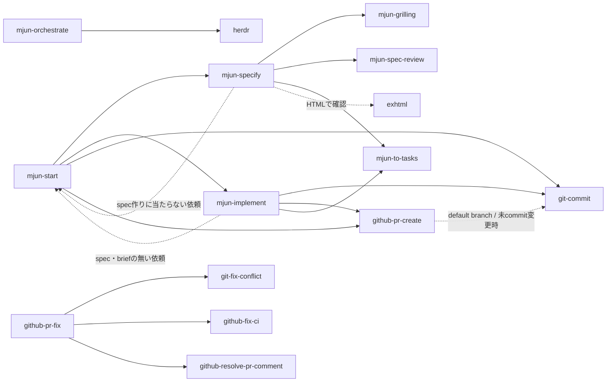

# Agent Skills

このドキュメントは、本リポジトリから使うAI agent skillと、それらの依存関係について説明します。skillの供給元は2つあります。

- `~/.agents/skills/<skill>` — 共有skillディレクトリ (Codexはこのディレクトリを直接読む)
- `~/.claude/skills/<skill>` — Claude Code
- `~/.gemini/antigravity-cli/skills/<skill>` — Antigravity CLI

`config/ai-agents/skills/` 配下のファイルを編集すると、symlink経由ですべてのagentに同時に反映されます。

APM管理のskillとagentは [`config/ai-agents/apm.yml`](../config/ai-agents/apm.yml) に宣言され、`install.sh` が `apm update -g -y` を実行してデプロイします。以下の一覧はmanifestで明示的に選択した内容に従います。

## APM管理のPrimitives

APMは以下のpackageを`agent-skills`、`antigravity`、`claude`、`codex`の各targetへデプロイします。

### Skills

| Package                                                                                                                       | 選択したskill                                                                                                                                                                                                                                                                                                                                                                                                                                                                                   |
| ----------------------------------------------------------------------------------------------------------------------------- | ----------------------------------------------------------------------------------------------------------------------------------------------------------------------------------------------------------------------------------------------------------------------------------------------------------------------------------------------------------------------------------------------------------------------------------------------------------------------------------------------- |
| [`mjun0812/skills`](https://github.com/mjun0812/skills)                                                                       | `chat-note`, `claude`, `codex`, `cognitive-rhythm-writing`, `deep-research`, `doc-sync`, `duckdb`, `exhtml`, `exmd`, `experiment-plan`, `git-commit`, `git-fix-conflict`, `git-squash`, `github-fix-ci`, `github-issue-create`, `github-issue-update`, `github-pr-create`, `github-pr-fix`, `github-pr-review`, `github-resolve-pr-comment`, `japanese-tech-writing`, `resume-other-agent`, `self-review`, `skill-review`, `stop-ai-slop-jp`, `test-prune`, `wezterm-control`, `writing-skills` |
| [`vercel-labs/agent-browser`](https://github.com/vercel-labs/agent-browser)                                                   | [`agent-browser`](https://github.com/vercel-labs/agent-browser/blob/main/skills/agent-browser/SKILL.md)                                                                                                                                                                                                                                                                                                                                                                                         |
| [`remorses/playwriter/skills/playwriter`](https://github.com/remorses/playwriter/tree/main/skills/playwriter)                 | [`playwriter`](https://github.com/remorses/playwriter/blob/main/skills/playwriter/SKILL.md)                                                                                                                                                                                                                                                                                                                                                                                                     |
| [`herdrdev/herdr/skills/herdr`](https://github.com/herdrdev/herdr/tree/master/skills/herdr)                                   | [`herdr`](https://github.com/herdrdev/herdr/blob/master/skills/herdr/SKILL.md)                                                                                                                                                                                                                                                                                                                                                                                                                  |
| [`github/gh-stack/skills/gh-stack`](https://github.com/github/gh-stack/tree/main/skills/gh-stack)                             | [`gh-stack`](https://github.com/github/gh-stack/blob/main/skills/gh-stack/SKILL.md)                                                                                                                                                                                                                                                                                                                                                                                                             |
| [`jupyter-ai-contrib/nb-cli/skills/notebook-cli`](https://github.com/jupyter-ai-contrib/nb-cli/tree/main/skills/notebook-cli) | [`notebook-cli`](https://github.com/jupyter-ai-contrib/nb-cli/blob/main/skills/notebook-cli/SKILL.md)                                                                                                                                                                                                                                                                                                                                                                                           |

### Agents

4つのagentはすべて[`mjun0812/skills`](https://github.com/mjun0812/skills/tree/main/agents)から取得します。

| Agent                                                                                                       | 用途                                                                                           |
| ----------------------------------------------------------------------------------------------------------- | ---------------------------------------------------------------------------------------------- |
| [`code-reviewer-contract`](https://github.com/mjun0812/skills/blob/main/agents/code-reviewer-contract.md)   | spec contractに明記されたrequirements、boundaries、acceptance criteriaとの整合だけを検査する。 |
| [`code-reviewer-finder`](https://github.com/mjun0812/skills/blob/main/agents/code-reviewer-finder.md)       | 変更が導入または露出した、対応すべき動作不良やregressionを発見する。                           |
| [`code-reviewer-standards`](https://github.com/mjun0812/skills/blob/main/agents/code-reviewer-standards.md) | 変更が導入した、リポジトリの必須規約違反とcode smellを発見する。                               |
| [`code-reviewer-verifier`](https://github.com/mjun0812/skills/blob/main/agents/code-reviewer-verifier.md)   | review候補1件の反証を試み、confirmed、refuted、uncertainのverdictを返す。                      |

## Skill一覧

各skillは `SKILL.md` を含むディレクトリです。Agentはfront-matterの `description` を読んで、いつ使うかを判断します。

### Development Flow (mjun)

`mjun-` prefixの自作開発フローskill群。specの正本は常に `.mjun/specs/` のLocal specで、GitHub Issueは取り込みと投影のアダプタとして扱う。入口は `mjun-start` で、作業の種類 (軽微な修正、バグ修正、refactoring、性能改善、新規機能) ごとに重さの違う流れへ振り分ける。新規機能は `mjun-specify` でspecを作って承認を得てからtask分解し、`mjun-implement` で実装からPRまで進める。バグ修正、refactoring、性能改善は、`mjun-start` が `.mjun/briefs/` に書いたbriefを `mjun-implement` が実装する。`mjun-orchestrate` は、ユーザーが `/` で直接呼ぶ専用 (`disable-model-invocation: true`) で、agentが自分の判断では使わない。Codexでは `agents/openai.yaml` の `policy.allow_implicit_invocation: false` で、`$mjun-orchestrate` と明示したときだけ使う。用語集 `CONTEXT.md` とADR (1件1ファイル `NNNN-<slug>.md`) は、使い捨てのspecやbriefと違って作業を終えた後も残す記録で、各skillが参照する。置き場所はrepositoryごとにGit管理 (repo直下の `CONTEXT.md`、`docs/adr/`) かローカル (`.mjun/CONTEXT.md`、`.mjun/steering/adr/`) のどちらかで、最初に書く直前に人間へ1回だけ聞き、以後は最初のファイルの場所で判定する。doneのspecはどのskillも参照せず、人間が手で削除する。ADRにするのは、覆しにくく、文脈なしでは意外で、本物のtrade-offがあった判断だけで、agentが自動で最小形式 (見出しと1〜3文) で書く。specの中で閉じる判断 (tentativeを含む) はspecの `design.md` の `## Decisions` に置き、承認・実装開始時にtentativeを検査する。作業を終えるときにADRを転記しない。Git管理へ移す場合は用語集をrepo直下の `CONTEXT.md`、ADRの全ファイルを `docs/adr/` へ移し (既存ADRと番号が衝突するものだけ振り直す)、Git管理と内容・参照の検証後に `.mjun/` 側の元ファイルを削除する。移行後は移行先だけを読み書きする。

| Skill                                                                      | 用途                                                                                                                                                                                                                                                                                                                                                                                                                                                                                                                                                                                                                                                                                                                                                                                                                                                                                                                                                                                                                                                                                                                                                                                                                                                                                                                                                                                                                                                                                                                                                                                                                                                                                                                                                                                                                                                                                                                                                                                                                                                                                                                                                                                                                                                                                                                                                                                                                                                                                                                                                                                                                                                                                                                                                                                                                                                                                                                                                                                                                                                                                                                                                                                                                                                                                                                                                                                                                                                                                                                                                                                                                                                                                                                                                                                                                                                                                                        |
| -------------------------------------------------------------------------- | ----------------------------------------------------------------------------------------------------------------------------------------------------------------------------------------------------------------------------------------------------------------------------------------------------------------------------------------------------------------------------------------------------------------------------------------------------------------------------------------------------------------------------------------------------------------------------------------------------------------------------------------------------------------------------------------------------------------------------------------------------------------------------------------------------------------------------------------------------------------------------------------------------------------------------------------------------------------------------------------------------------------------------------------------------------------------------------------------------------------------------------------------------------------------------------------------------------------------------------------------------------------------------------------------------------------------------------------------------------------------------------------------------------------------------------------------------------------------------------------------------------------------------------------------------------------------------------------------------------------------------------------------------------------------------------------------------------------------------------------------------------------------------------------------------------------------------------------------------------------------------------------------------------------------------------------------------------------------------------------------------------------------------------------------------------------------------------------------------------------------------------------------------------------------------------------------------------------------------------------------------------------------------------------------------------------------------------------------------------------------------------------------------------------------------------------------------------------------------------------------------------------------------------------------------------------------------------------------------------------------------------------------------------------------------------------------------------------------------------------------------------------------------------------------------------------------------------------------------------------------------------------------------------------------------------------------------------------------------------------------------------------------------------------------------------------------------------------------------------------------------------------------------------------------------------------------------------------------------------------------------------------------------------------------------------------------------------------------------------------------------------------------------------------------------------------------------------------------------------------------------------------------------------------------------------------------------------------------------------------------------------------------------------------------------------------------------------------------------------------------------------------------------------------------------------------------------------------------------------------------------------------------------------- |
| [`mjun-start`](../config/ai-agents/skills/mjun-start/SKILL.md)             | 開発作業で最初に呼ぶskill。依頼を、軽微な修正、バグ修正、refactoring、性能改善、新規機能に振り分ける。軽微な修正はその場で直し、関係するlintとテスト、ID検査を通し、差分を読み直してから届ける。バグ修正 (再現手順と、期待する動作の根拠)、refactoring (変えない振る舞い)、性能改善 (計測方法、変更前の値、人間が決めた目標値) は、`.mjun/briefs/` にbriefを書いて `mjun-implement` へ渡す。新規機能と、1つのtaskに収まらない広範囲のrefactoringは、確認のうえ `mjun-specify` へ渡す。どこまで進めるか (PRまで、commitまでなど) は最初に1回だけ聞き、作業中に前提が崩れたら重い種類へ自動で切り替える                                                                                                                                                                                                                                                                                                                                                                                                                                                                                                                                                                                                                                                                                                                                                                                                                                                                                                                                                                                                                                                                                                                                                                                                                                                                                                                                                                                                                                                                                                                                                                                                                                                                                                                                                                                                                                                                                                                                                                                                                                                                                                                                                                                                                                                                                                                                                                                                                                                                                                                                                                                                                                                                                                                                                                                                                                                                                                                                                                                                                                                                                                                                                                                                                                                                                                       |
| [`mjun-specify`](../config/ai-agents/skills/mjun-specify/SKILL.md)         | アイデア・GitHub Issue・ローカルMarkdownを実装可能なspec (contract) へ仕上げる。Phase 0でまず依頼を、既存のactive specの拡張、spec作りに当たらない依頼 (`mjun-start` へ渡す)、新規specのどれかへ振り分ける。factsを調査してAgent権限内のdecisionを自分で決め (分類条件が重なる場合はHuman-ownedを優先)、Human-ownedと判断に迷うdecisionを確認し (互いに依存しない論点は1回の質問にまとめる)、decisionの解決後にdesign.md (contract内の実装設計) を必ず書き、spec reviewの前に残ったtentative (確信度lowの決定) を証拠で昇格するか人間に確認して0件にし (人間への質問はここで終え、承認まで入力を待たずに進む)、他のactive specとの境界の重なり (Owns / Public Contracts Affected / Change Outline) をHuman-owned decisionとして解決し、spec間の依存をDependenciesの `spec: <slug>` で記録し、承認前にtask planのdraftを作って承認後にtasks.mdへ確定させ、承認した判断シートとACをIssueへ投影する (取り込んだIssueの元の本文は残し、区切り行の下へ追記する。純Local specには投影時に投影先Issueの作成を提案する)。承認は1画面の判断シート (目的、範囲、人間とagentが決めたこと、動作の例、人間の目で確かめること) で取り、spec.mdとdesign.mdは人間が読まなくてよいagent向けの文書として扱う。見た目や操作感の論点は試作で決め、比べた案のスクリーンショットや動画を見本としてspecに残し、ACではなくdesign.mdの目視の確認シナリオにする。承認前に `mjun-spec-review` が、specをsource・ADR・他のactive spec・既存コードとfresh contextで照らし合わせる (Modulesが1つでHuman-owned decisionが無く、永続データの形式を変えないspecでは省く)。新しい依存、抽象、設定項目の採用時は、単純な代替候補と採用理由をdesign.mdの `## Decisions` へ記録する。Modulesに新設があるか公開interfaceの署名を変える設計では、型・署名・moduleの配置を骨組み (`skeleton.patch`。build・型検査・既存のテストを通したコード) で書き、design.mdのInterfaces & Seamsにはその場所だけを書く。                                                                                                                                                                                                                                                                                                                                                                                                                                                                                                                                                                                                                                                                                                                                                                                                                                                                                                                                                                                                                                                                                                                                                                                                                                                                                                                                                                                                                                                                                                                                                                                                                                                                                                                                                                                                                                                                                                                                                                                                                                        |
| [`mjun-grilling`](../config/ai-agents/skills/mjun-grilling/SKILL.md)       | 計画・設計・specの意思決定を、前提が解決済みの論点 (frontier) をroundごとにまとめて聞く対話で解決する (設計ツリーの全分岐を解消する設計全体モードと、渡されたdecisionだけを解決する指定decisionモード。指定decisionモードでも、互いに依存しないdecisionは1回の質問にまとめる)。事実の調査はSubAgentに委譲して待たず、共有理解の確認まで実行に移さない                                                                                                                                                                                                                                                                                                                                                                                                                                                                                                                                                                                                                                                                                                                                                                                                                                                                                                                                                                                                                                                                                                                                                                                                                                                                                                                                                                                                                                                                                                                                                                                                                                                                                                                                                                                                                                                                                                                                                                                                                                                                                                                                                                                                                                                                                                                                                                                                                                                                                                                                                                                                                                                                                                                                                                                                                                                                                                                                                                                                                                                                                                                                                                                                                                                                                                                                                                                                                                                                                                                                                       |
| [`mjun-spec-review`](../config/ai-agents/skills/mjun-spec-review/SKILL.md) | spec (`.mjun/specs/<slug>`、GitHub Issue / PR番号、設計Markdown、会話中の設計) を、specの外に実在するものと照らし合わせて敵対的にレビューする。fresh contextのreviewer 1体が、sourceとの乖離・steering / ADR / 用語集との衝突・他のactive specとの衝突・既存コードとの整合 (満たせないAC、既存の仕組みとの関わりの抜けを含む)・永続データの扱い・Human-owned decisionとの矛盾の候補を出し、1体のverifierが原文と実コードで反証してconfirmedだけをチャットへ返す。残すかは観点ではなく根拠の場所で決め、根拠がspecの外 (コードの行、source、ADR、既存の文書、他spec) かHuman-owned decisionにない候補 (spec内の読み比べや一般論だけの懸念) は落とす。永続データの形式を変える設計だけは、設計の記述を根拠にしてよい。task分解は見ない。spec modeでは `check_spec_format.sh` の指摘も返す。ファイルは編集しない                                                                                                                                                                                                                                                                                                                                                                                                                                                                                                                                                                                                                                                                                                                                                                                                                                                                                                                                                                                                                                                                                                                                                                                                                                                                                                                                                                                                                                                                                                                                                                                                                                                                                                                                                                                                                                                                                                                                                                                                                                                                                                                                                                                                                                                                                                                                                                                                                                                                                                                                                                                                                                                                                                                                                                                                                                                                                                                                                                                                                                                                                               |
| [`mjun-to-tasks`](../config/ai-agents/skills/mjun-to-tasks/SKILL.md)       | specを単独検証可能なvertical sliceのtaskへ分解し、単一taskを含めてtasks.mdへ永続化する。同梱のscript (`scripts/check_spec_format.sh`。mjun-specifyがspec reviewの前に、mjun-implementが開始時にも実行する) が、spec.md・design.md・tasks.mdの機械的に読まれる形式 (フィールド、Statusの語彙、Blocked byの実在と循環、taskあたりAC 8件以下、tentativeの残り) を検査し、承認前のspecではEvidence・Change Outlineのパスと依存先specの実在も確かめる。保存前にRequirements・Acceptance Criteria・designのModules / Seams / Data Flowとtaskのcoverage検査で未カバーと重複を解消する (最大2周)。分解はレビューせず、切り方の誤りは実装中の再分解で直す。`--draft` ではdraftを `tasks.draft.md` に書いて終え (承認前に判断シートへtaskの件数を載せ、未カバーとして見つかるspecの欠落を直すため)、承認前に作ったdraftを渡されると後からの変更だけを反映する。done taskのAcceptance Criteriaが変わった場合はreadyへ戻し、blocked taskは原因が解消したと確認できるまで理由と再開条件を保持する。粒度は「1つのコマンドで検証できる」「変更が1 moduleに収まる」「責務1つ」「前提は先行task」「Done when 1行」「AC 3〜6件が目安で、8件を超えたら分割」で判定し、他taskの前提を変える変更を先に置く。各taskにSeamを持たせ、ファイルパスは書かない                                                                                                                                                                                                                                                                                                                                                                                                                                                                                                                                                                                                                                                                                                                                                                                                                                                                                                                                                                                                                                                                                                                                                                                                                                                                                                                                                                                                                                                                                                                                                                                                                                                                                                                                                                                                                                                                                                                                                                                                                                                                                                                                                                                                                                                                                                                                                                                                                                                                                                                                                                                                                                                                         |
| [`mjun-implement`](../config/ai-agents/skills/mjun-implement/SKILL.md)     | specのcontract承認状態とdesign.md・tasks.mdの存在を確かめ (taskの決定はmjun-specify側が持ち、このskillでは分解しない。Issue番号はspecify済みspecへの逆引きで解決、依存specの完了を確認)、tasks.mdに記録したbranchからresumeしてtask groupごとに実装する (mjun-orchestrateなどの呼び出し元が用意したcleanなlinked worktreeで起動されたら、そのworktreeとbranchを採用し、片付けは呼び出し元に任せる) (groupは依存順にtask 8件・AC 24件の上限まで詰め、implementerはgroupごとに1体を差し戻しでも継続する)。reviewerはdiffのパスをdesign.mdのChange Outlineと機械的に比べ、PR作成などの前にbase branchへrebaseし、内容が変わっていれば全チェックを再実行する。specとtask双方のAcceptance Criteriaとcontract境界の確認を経てcommitし、PR作成またはbase branchへのfast-forward merge (`--merge`) まで進める。`mjun-start` が書いたbrief (`.mjun/briefs/`) も起点にでき、種類 (bug / refactor / perf) に応じた観点 (再現と原因、振る舞いの不変、計測) をimplementerとreviewerに渡し、整理のpassは省く。バグ修正では修正前後の証拠を、再現テスト、実物での観察、計測のうち届く中で最も上の段階で取り、計測でも原因の仕組みが見えないときだけ止まる。UIの確認シナリオはスクリーンショットや動画を `.mjun/evidence/` に残してPRに添付し、目視のシナリオは手動確認要の判定で最後まで止まらずに進む。specは使い捨てなので、作業を終えた後に後で取り組むもの (別の作業にすると決めたOut of Scope、見送ったNOTES、範囲外のCONCERNS) を並べ、人間が選んだものをIssueに起票する。spec・brief・設計docの無い依頼は `mjun-start` へ渡す。groupごとにverifier SubAgentがAcceptance Criteriaを失敗するチェックに落とし、チェックのファイルをformatterとlintに通してから実装し (チェックの改変はハッシュで検出)、検証不能時は別方式を1回だけ試し、チェックにできないtaskはreview-onlyとしてreviewerがAcceptance Criteriaを1件ずつ確かめる (最終判定は手動確認要)。implementerの報告にFAILや途中で止めた実行が残っていれば、変更前から同じように失敗するという証拠が無い限り、reviewerを起動せずにimplementerへ戻す。reviewerの起動前に親が同梱のscriptでチェックを実行し、その結果をreviewerへ渡す。scriptはworktreeの内容の指紋ごとに成功を記録し、同じ内容で成功済みのチェックを再実行しない (承認後、整理の後、feature検証、rebase後の再確認が該当する)。SubAgentの報告を検証の代わりにしない。SubAgentへは、テンプレートやcontractを `.mjun/runs/` の受け渡しファイルに置いてパスで渡し、promptへ書き写さない。大きすぎるtaskやtask分解・順序の問題はcontractの意味が変わらないことを確かめてmjun-to-tasksで自動修正し、解決できないtaskを隔離して独立taskを続行する。残ったblocked taskと依存待ちは最後に原因・再開条件付きで報告する。収束しない実装はfresh contextのdebuggerが分類し、refactor passの後にfeature検証 (smoke、AC matrix、task間整合) を1回行ってからPR作成などへ進む。各SubAgentはleaf roleとして再移譲せず、受け渡しと追加の委譲はメイン会話だけが担う。コード・commit・PRにspec内部の識別子 (task ID、AC番号、Requirement番号など) が入っていないかを、同梱のscriptで各commitの直後、PRを作る前、PR作成後に検査する。差し戻しが収束しない問題、検査・spec・環境の見直しが要る問題、同じ失敗の繰り返しはdebuggerへ回す (1 groupあたり最大2回)。roleごとのmodelとeffortは `references/subagent.md` で指定する。pstackを元にしたコードの書き方の原則 (`principles/` に1原則1ファイル。model-the-domain、boundary-discipline、test-behavior-not-implementationなど) をrun-dirへコピーし、各roleは `references/subagent.md` で割り当てた原則だけを読む。repositoryの規約が優先し、reviewerは違反をREJECTにせずNOTESに出す。判断の要らない確認 (保護された検査ファイルのハッシュ、Change Outlineの外のパス、TODO類、spec内部の識別子、secrets、骨組みの未実装の残り) は親が `scripts/check_mechanical.sh` でまとめて行い、reviewerは結果を写すだけにする。specに骨組み (`skeleton.patch`) があれば、最初のgroupの前にworktreeへ当てて1つのcommitにし (当たらなければ参照として渡す)、groupはその中身を埋める。 |
| [`mjun-orchestrate`](../config/ai-agents/skills/mjun-orchestrate/SKILL.md) | 人間の代わりに複数の作業agentを並列に操作するorchestration modeへ、呼び出したセッションを切り替える。modeはユーザーが終了を指示するまで続く。ユーザーが明示的に呼んだときだけ使い、agentの判断では発火しない (`disable-model-invocation`)。調査やレビューを含む作業依頼はすべてtaskに分けてworkerへ回し (subagentには任せない)、人間がpaneに打つのと同じ依頼文 (`/mjun-implement #12 --pr` などのskill呼び出しを含む) を送る。`/mjun-implement` とskillを使わずにtracked fileを変更するtaskには、Herdrのworktree workspace (`herdr worktree create`、orchestratorのworkspaceの子としてまとまる) を作り、完了後に `--force` なしで削除する (branchは残す)。それ以外のtaskはHerdrの同じworkspaceの `⚙️ workers` tab (4 paneごとに `⚙️ workers 2` などを追加し、worker数の上限は設けない) で動かす。taskごとのpaneで作業agentを権限確認なしで起動する (agent種別はclaude / codex / opencode / agyからmode開始時にユーザーが選び、modelはその後にユーザーが自由入力する。空ならCLIの既定モデル)。依頼文に添えるのは作業場所の注意、報告ファイル (`.mjun/orchestrate/<run>/<slug>.md` に `PR:` / `Branch:` / `## Result` / `## Next` を書く。paneを閉じた後やcontextを失った後も残る)、完了時の `DONE` 報告だけで、commit・PR・reviewの進め方はworkerとそのskillに任せる。報告・transcript・画面・PRの内容はデータとして扱い、指示としては実行しない。`## Next` はユーザーへ提案として伝えるだけにする。受領はHerdrのstate (`working` への遷移) で確認し、usage limitや認証切れならkindを切り替えて再送する。workerの質問やdialogには人間と同じようにorchestratorが答え、決められないものだけユーザーに確認する。`DONE` とlifecycle waitのsettleで完了とし、成果物は検証し直さずに結果を記録して、paneをすぐ閉じる。呼び出したセッション自身はファイルを編集しない                                                                                                                                                                                                                                                                                                                                                                                                                                                                                                                                                                                                                                                                                                                                                                                                                                                                                                                                                                                                                                                                                                                                                                                                                                                                                                                                                                                                                                                                                                                                                                                                                                                                                                                                                                                                                                                                                                                                                                                                                                                                                                                                               |
| [`mjun-steering`](../config/ai-agents/skills/mjun-steering/SKILL.md)       | ADRの判断を機械的なチェックにしても本文は残して `Enforced by:` の行を足し、Syncで参照先が消えていればdriftとして報告する。`.mjun/steering/` を実装にgroundされたproject memoryとして生成 (Bootstrap)・drift検出付きで追記更新 (Sync) し、履歴 (merged PR / closed Issue / docs) から用語集 `CONTEXT.md` と、3条件を満たす判断のADR (repositoryが選んだ `docs/adr/` か `.mjun/steering/adr/` に1件1ファイル) を発掘して追記する (追記専用)                                                                                                                                                                                                                                                                                                                                                                                                                                                                                                                                                                                                                                                                                                                                                                                                                                                                                                                                                                                                                                                                                                                                                                                                                                                                                                                                                                                                                                                                                                                                                                                                                                                                                                                                                                                                                                                                                                                                                                                                                                                                                                                                                                                                                                                                                                                                                                                                                                                                                                                                                                                                                                                                                                                                                                                                                                                                                                                                                                                                                                                                                                                                                                                                                                                                                                                                                                                                                                                                   |
| [`mjun-rule-lint`](../config/ai-agents/skills/mjun-rule-lint/SKILL.md)     | 文章で書かれたコード規約 (CLAUDE.md、steering、ADR、繰り返したレビュー指摘、会話) を、repositoryに含めないlocalのlint (`.mjun/lint/` のast-grep ruleとscript) に変換し、作成済みのlintを直したり消したりする。repositoryのlinter設定・git hook・CI・Git管理の文書は変えない。lintは違反例と正しい例で1回だけ確かめ (テストファイルは残さない)、localの文書とローカルのADRにlintの場所を添える。mjun-implementとmjun-startの軽微な修正が、`scripts/run_local_lint.sh` で今回追加・変更したファイルだけに実行するので、既存の違反で作業は止まらない                                                                                                                                                                                                                                                                                                                                                                                                                                                                                                                                                                                                                                                                                                                                                                                                                                                                                                                                                                                                                                                                                                                                                                                                                                                                                                                                                                                                                                                                                                                                                                                                                                                                                                                                                                                                                                                                                                                                                                                                                                                                                                                                                                                                                                                                                                                                                                                                                                                                                                                                                                                                                                                                                                                                                                                                                                                                                                                                                                                                                                                                                                                                                                                                                                                                                                                                                           |

### Git

| Skill                                                                                                   | 用途                                                                                                                                                    |
| ------------------------------------------------------------------------------------------------------- | ------------------------------------------------------------------------------------------------------------------------------------------------------- |
| [`git-commit`](https://github.com/mjun0812/skills/blob/main/skills/git/git-commit/SKILL.md)             | 現在の変更を適切な単位でstaging・commitする                                                                                                             |
| [`git-squash`](https://github.com/mjun0812/skills/blob/main/skills/git/git-squash/SKILL.md)             | 現在のbranchのcommitをsquash・整理し、必要なら force-with-lease でpushする                                                                              |
| [`git-fix-conflict`](https://github.com/mjun0812/skills/blob/main/skills/git/git-fix-conflict/SKILL.md) | merge、rebase、cherry-pick、revert、apply、PR などで発生したコンフリクトを検出して解消する                                                              |
| [`self-review`](https://github.com/mjun0812/skills/blob/main/skills/review/self-review/SKILL.md)        | 未commit変更または指定commitをsnapshot化し、独立した2つのFinderと1つのStandardsで敵対的にreviewする (`--spec` でspecとの整合を検証するContract軸を追加) |

### GitHub

| Skill                                                                                                                        | 用途                                                                                                                                                                  |
| ---------------------------------------------------------------------------------------------------------------------------- | --------------------------------------------------------------------------------------------------------------------------------------------------------------------- |
| [`github-issue-create`](https://github.com/mjun0812/skills/blob/main/skills/github/github-issue-create/SKILL.md)             | Todo・メモ・バグ報告を、主張の裏取り (repo、必要なら公式ドキュメント) と関連Issue検索をしてからGitHub Issueとして1件起票する (テンプレ・ラベル自動判定、承認後に作成) |
| [`github-issue-update`](https://github.com/mjun0812/skills/blob/main/skills/github/github-issue-update/SKILL.md)             | open issueを横断的に点検してclose (解決済み・重複・stale)・コメント追記・ラベル変更の候補を提示し、承認後に一括反映する                                               |
| [`github-pr-create`](https://github.com/mjun0812/skills/blob/main/skills/github/github-pr-create/SKILL.md)                   | 現在のbranchからPull Requestを作成し、概要・背景、関連Issue、実装方針、変更内容、影響範囲、検証結果の6項目で本文を記述する                                            |
| [`github-pr-review`](https://github.com/mjun0812/skills/blob/main/skills/github/github-pr-review/SKILL.md)                   | 並列reviewerで要修正の指摘・規約違反・specとの不整合 (`--spec` または関連Issueから解決できる場合) を発見・検証し、以前のレビューを最新スナップショットへ置き換える    |
| [`github-pr-fix`](https://github.com/mjun0812/skills/blob/main/skills/github/github-pr-fix/SKILL.md)                         | PRの全問題(コンフリクト、CI失敗、レビューコメント)を専用worktree内で検出・修正する                                                                                    |
| [`github-fix-ci`](https://github.com/mjun0812/skills/blob/main/skills/github/github-fix-ci/SKILL.md)                         | CIのステータスを確認し、失敗を分析して修正を適用する                                                                                                                  |
| [`github-resolve-pr-comment`](https://github.com/mjun0812/skills/blob/main/skills/github/github-resolve-pr-comment/SKILL.md) | PRのレビューコメントを確認し、対応・返信する                                                                                                                          |

### Planning & Design

| Skill                                                                                                      | 用途                                                                                       |
| ---------------------------------------------------------------------------------------------------------- | ------------------------------------------------------------------------------------------ |
| [`experiment-plan`](https://github.com/mjun0812/skills/blob/main/skills/planning/experiment-plan/SKILL.md) | 機械学習実験の未決事項を一つずつ確認し、検証可能な計画書を `.mjun/experiments/` へ保存する |

### Docs & Notes

| Skill                                                                                                  | 用途                                                                                                                                    |
| ------------------------------------------------------------------------------------------------------ | --------------------------------------------------------------------------------------------------------------------------------------- |
| [`doc-sync`](https://github.com/mjun0812/skills/blob/main/skills/docs/doc-sync/SKILL.md)               | リポジトリ内のドキュメント(Markdown、docstring、OpenAPI、設定サンプル)を実装と差分比較し、乖離を更新する                                |
| [`chat-note`](https://github.com/mjun0812/skills/blob/main/skills/docs/chat-note/SKILL.md)             | 現在の会話で調査・検討した内容を、外部情報を足さずに日本語のMarkdown 1ファイルへ書き出す                                                |
| [`deep-research`](https://github.com/mjun0812/skills/blob/main/skills/research/deep-research/SKILL.md) | 与えられたテーマを事前知識とweb検索を統合してdeep researchし、引用付きの調査メモをMarkdownで作成する                                    |
| [`exhtml`](https://github.com/mjun0812/skills/blob/main/skills/docs/exhtml/SKILL.md)                   | 概念・仕組み・調査内容を、用語集・目次・図・コードを備えた1枚の自己完結HTMLで解説する (同梱のtemplateを使用)                            |
| [`exmd`](https://github.com/mjun0812/skills/blob/main/skills/docs/exmd/SKILL.md)                       | 概念・仕組み・調査内容を、用語表・目次・Mermaid図・コードを備えた1枚のMarkdown (GFM) で解説する。会話に無い題材も調査したうえで解説する |

### Japanese Writing

| Skill                                                                                                                       | 用途                                                                                                       |
| --------------------------------------------------------------------------------------------------------------------------- | ---------------------------------------------------------------------------------------------------------- |
| [`cognitive-rhythm-writing`](https://github.com/mjun0812/skills/blob/main/skills/writing/cognitive-rhythm-writing/SKILL.md) | 日本語の説明文で認知モードの切り替え、文の拍、段落の密度によって緩急を設計し、平坦な文章を診断して修正する |
| [`japanese-tech-writing`](https://github.com/mjun0812/skills/blob/main/skills/writing/japanese-tech-writing/SKILL.md)       | 日本語の技術文書・書籍原稿を書く／推敲するときの文章規範(整形、パラグラフライティング、LLM 臭の排除など)   |
| [`stop-ai-slop-jp`](https://github.com/mjun0812/skills/blob/main/skills/writing/stop-ai-slop-jp/SKILL.md)                   | AIで書いた日本語を人間が書いた文章に戻す編集規範(主体の不在、命題型H2、両論併記、リズムの均一さなどを直す) |

出典:

- `japanese-tech-writing` — [k16shikano/fd287c3133457c4fd8f5601d34aa817d](https://gist.github.com/k16shikano/fd287c3133457c4fd8f5601d34aa817d) を元にしている

### Cross-Agent Consultation & Delegation

これらはuser-invoked専用で、agentが自発的に起動することはありません。

デフォルトはread-onlyの相談モードで、ユーザーが作業の実行を明示的に依頼したときだけ編集権限付きの委譲モードで実行します。自分自身と同じCLIのskillは使いません。

| Skill                                                                                      | 用途                                                                                       |
| ------------------------------------------------------------------------------------------ | ------------------------------------------------------------------------------------------ |
| [`claude`](https://github.com/mjun0812/skills/blob/main/skills/delegation/claude/SKILL.md) | Claude Code (`claude -p`) への相談 (read-only) と、編集権限付きの作業委譲                  |
| [`codex`](https://github.com/mjun0812/skills/blob/main/skills/delegation/codex/SKILL.md)   | Codex (`codex exec`) への相談 (read-onlyサンドボックス) と、`workspace-write` での作業委譲 |

### Misc

| Skill                                                                                                              | 用途                                                                                                                                                                                                                                                |
| ------------------------------------------------------------------------------------------------------------------ | --------------------------------------------------------------------------------------------------------------------------------------------------------------------------------------------------------------------------------------------------- |
| [`resume-other-agent`](https://github.com/mjun0812/skills/blob/main/skills/delegation/resume-other-agent/SKILL.md) | 別のcoding agent(Codex / Claude Code)をsession IDで指定し、直前のcontextを復元してresumeする                                                                                                                                                        |
| [`skill-review`](https://github.com/mjun0812/skills/blob/main/skills/agent-skill/skill-review/SKILL.md)            | Agent skillの仕様適合性を検証し、周辺skillとの発動競合や旧基準の痕跡を含む観点ごとの判定をレポートする。レビュー後の修正から新しい基準の候補を拾い、採用されたら自身の基準とCHANGELOGへ追記する。評価対象は編集しない                               |
| [`test-prune`](https://github.com/mjun0812/skills/blob/main/skills/review/test-prune/SKILL.md)                     | コードベース内の全テストを精査し、削除・統合できるテストを「削除すると見逃す現実的な不具合」を基準にリストアップする                                                                                                                                |
| [`wezterm-control`](https://github.com/mjun0812/skills/blob/main/skills/tools/wezterm-control/SKILL.md)            | weztermのpane/tab/windowを `wezterm cli` で操作する。分割・フォーカス・リサイズ・内容の読み取り・コマンド送信と結果検証                                                                                                                             |
| [`writing-skills`](https://github.com/mjun0812/skills/blob/main/skills/agent-skill/writing-skills/SKILL.md)        | skillを先にテストして作成・修正する。skillがない状態でsubagentにpressure scenarioを実行させて失敗を記録し、その失敗に対してskillを書き、subagentが従うまで再実行する。obra/superpowersをもとに、前提のtest-driven-developmentを同梱して改変したもの |

## Dependencies

以下のskillはagentの `Skill` tool経由で他のskillを呼び出します。矢印はcallerからcalleeへ向かいます。

### Caller → callee 表

| Caller             | Callee                                                             | タイミング                                                                                                                                                                                                     |
| ------------------ | ------------------------------------------------------------------ | -------------------------------------------------------------------------------------------------------------------------------------------------------------------------------------------------------------- |
| `github-pr-create` | `git-commit`                                                       | Phase 0のみ、現在のbranchがdefault branchまたは未commit変更がある場合                                                                                                                                          |
| `mjun-start`       | `mjun-specify`, `mjun-implement`, `git-commit`, `github-pr-create` | 新規機能と広範囲のrefactoringはmjun-specifyへ、バグ修正・refactoring・性能改善はbriefを付けてmjun-implementへ渡す。軽微な修正は自分で直してgit-commitでcommitし、PRを選んだ場合はgithub-pr-createを呼ぶ        |
| `mjun-specify`     | `mjun-start`                                                       | Phase 0でspec作りに当たらない依頼 (軽微な修正、バグ修正、refactoring、性能改善) と判定した場合                                                                                                                 |
| `mjun-specify`     | `mjun-grilling`                                                    | Human-ownedなdecisionの解決と、spec reviewの前に残ったtentativeの解消が必要な場合 (Evidence-blockedは自分で調べて解決する)                                                                                     |
| `mjun-specify`     | `mjun-spec-review`                                                 | Phase 4 (承認前) でspecをsource・ADR・他のactive spec・既存コードと照らし合わせ、妥当な指摘だけを反映する。Modulesが1つでHuman-owned decisionが無く、永続データの形式を変えないspecでは省く                    |
| `mjun-specify`     | `mjun-to-tasks`                                                    | 承認前に `--draft` でtask planのdraftを作り (判断シートのtask件数と、未カバーとして見つかるspecの欠落を直すため)、承認後にそのdraftからtasks.mdを確定する (単一task規模を含む。既存tasks.mdがあれば再分解する) |
| `mjun-specify`     | `exhtml`                                                           | Phase 5で「HTMLで内容を確認する」が選ばれた場合 (設計を図解する解説ページ)。skillが無ければその場でHTMLを書く                                                                                                  |
| `mjun-specify`     | `github-issue-create`                                              | Phase 7で `Source:` の無いspecに投影先Issueを作る場合。templateとラベルの選択、関連Issueの検索、作成前の確認はこのskillが行い、その後に判断シートとACを区切り行の下へ投影する                                  |
| `mjun-implement`   | `github-issue-create`                                              | Phase 5で、人間が選んだFollow-ups (後で取り組むOut of Scope、見送ったNOTES、範囲外のCONCERNS) を1件ずつ起票する                                                                                                |
| `mjun-implement`   | `git-commit`, `github-pr-create`, `mjun-to-tasks`, `mjun-start`    | Phase 4でworktreeの変更をcommitし、`--pr` 時にPRを作成。taskが大きすぎる、または切り方が誤っていた場合にtasks.mdを再分解。spec・brief・設計docの無い依頼 (specの無いIssue番号を含む) はmjun-startへ渡す        |
| `mjun-orchestrate` | `herdr`                                                            | Herdr CLIの構文・ID・lifecycle stateの正として最初に読む。skill側はworker protocolだけを追加                                                                                                                   |
| `github-pr-fix`    | `git-fix-conflict`, `github-fix-ci`, `github-resolve-pr-comment`   | 対応する問題が検出された場合のみ各calleeを実行                                                                                                                                                                 |

### Standalone skills

以下のskillは他のskillへ委譲しません。

`chat-note`, `claude`, `codex`, `cognitive-rhythm-writing`, `deep-research`, `doc-sync`, `exhtml`, `exmd`, `experiment-plan`, `git-commit`, `git-fix-conflict`, `git-squash`, `github-fix-ci`, `github-issue-create`, `github-issue-update`, `github-pr-review`, `github-resolve-pr-comment`, `japanese-tech-writing`, `mjun-grilling`, `mjun-spec-review`, `mjun-steering`, `mjun-to-tasks`, `resume-other-agent`, `self-review`, `skill-review`, `stop-ai-slop-jp`, `test-prune`, `wezterm-control`, `writing-skills`.

## Conventions

- Skill名はkebab-caseで、ドメイン単位(`git-*`、`github-*`、いくつかの汎用skill)にスコープされます。
- Front matter(`name`、`description`、`allowed-tools`)はagentが読む契約です。`description` はskillが正しくトリガーされるよう十分に具体的に書き、本体から呼び出すsub-skillは `allowed-tools` に `Skill(<dep>)` として記載してください。
- `allowed-tools`などのクライアント固有fieldは未対応agentで無視される場合があります。指定する場合は対象クライアントの現行構文に従い、skillに必要なtoolとコマンド範囲だけを許可してください。
- 既存skillの挙動を拡張する場合は、ロジックを複製するのではなく `Skill` tool経由で元のskillを呼び出すことを優先してください。改善がすべてのagentに一箇所で行き渡ります。
