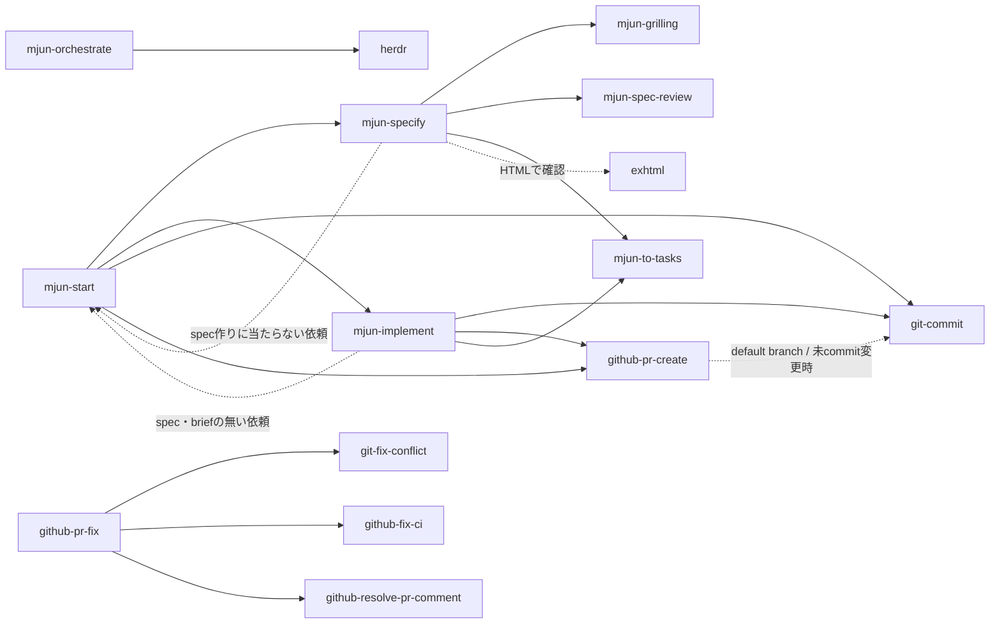

# Agent Skills

このドキュメントは、本リポジトリから使うAI agent skillと、それらの依存関係について説明します。skillの供給元は2つあります。

- `~/.agents/skills/<skill>` — 共有skillディレクトリ (Codexはこのディレクトリを直接読む)
- `~/.claude/skills/<skill>` — Claude Code
- `~/.gemini/antigravity-cli/skills/<skill>` — Antigravity CLI

`config/ai-agents/skills/` 配下のファイルを編集すると、symlink経由ですべてのagentに同時に反映されます。

APM管理のskillとagentは [`config/ai-agents/apm.yml`](../config/ai-agents/apm.yml) に宣言され、`install.sh` が `apm update -g -y` を実行してデプロイします。以下の一覧はmanifestで明示的に選択した内容に従います。

## APM管理のPrimitives

APMは以下のpackageを`agent-skills`、`antigravity`、`claude`、`codex`の各targetへデプロイします。

### Skills

| Package                                                                                                                           | 選択したskill                                                                                                                                                                                                                                                                                                                                                                                                                                                                                   |
| --------------------------------------------------------------------------------------------------------------------------------- | ----------------------------------------------------------------------------------------------------------------------------------------------------------------------------------------------------------------------------------------------------------------------------------------------------------------------------------------------------------------------------------------------------------------------------------------------------------------------------------------------- |
| [`mjun0812/skills`](https://github.com/mjun0812/skills)                                                                           | `chat-note`, `claude`, `codex`, `cognitive-rhythm-writing`, `deep-research`, `doc-sync`, `duckdb`, `exhtml`, `exmd`, `experiment-plan`, `git-commit`, `git-fix-conflict`, `git-squash`, `github-fix-ci`, `github-issue-create`, `github-issue-update`, `github-pr-create`, `github-pr-fix`, `github-pr-review`, `github-resolve-pr-comment`, `japanese-tech-writing`, `resume-other-agent`, `self-review`, `skill-review`, `stop-ai-slop-jp`, `test-prune`, `wezterm-control`, `writing-skills` |
| [`vercel-labs/agent-browser`](https://github.com/vercel-labs/agent-browser)                                                       | [`agent-browser`](https://github.com/vercel-labs/agent-browser/blob/main/skills/agent-browser/SKILL.md)                                                                                                                                                                                                                                                                                                                                                                                         |
| [`remorses/playwriter/skills/playwriter`](https://github.com/remorses/playwriter/tree/main/skills/playwriter)                     | [`playwriter`](https://github.com/remorses/playwriter/blob/main/skills/playwriter/SKILL.md)                                                                                                                                                                                                                                                                                                                                                                                                     |
| [`herdrdev/herdr/skills/herdr`](https://github.com/herdrdev/herdr/tree/master/skills/herdr)                                       | [`herdr`](https://github.com/herdrdev/herdr/blob/master/skills/herdr/SKILL.md)                                                                                                                                                                                                                                                                                                                                                                                                                  |
| [`modem-dev/hunk/packages/hunk/skills/hunk-review`](https://github.com/modem-dev/hunk/tree/main/packages/hunk/skills/hunk-review) | [`hunk-review`](https://github.com/modem-dev/hunk/blob/main/packages/hunk/skills/hunk-review/SKILL.md)                                                                                                                                                                                                                                                                                                                                                                                          |
| [`github/gh-stack/skills/gh-stack`](https://github.com/github/gh-stack/tree/main/skills/gh-stack)                                 | [`gh-stack`](https://github.com/github/gh-stack/blob/main/skills/gh-stack/SKILL.md)                                                                                                                                                                                                                                                                                                                                                                                                             |
| [`jupyter-ai-contrib/nb-cli/skills/notebook-cli`](https://github.com/jupyter-ai-contrib/nb-cli/tree/main/skills/notebook-cli)     | [`notebook-cli`](https://github.com/jupyter-ai-contrib/nb-cli/blob/main/skills/notebook-cli/SKILL.md)                                                                                                                                                                                                                                                                                                                                                                                           |

### Agents

4つのagentはすべて[`mjun0812/skills`](https://github.com/mjun0812/skills/tree/main/agents)から取得します。

| Agent                                                                                                       | 用途                                                                                           |
| ----------------------------------------------------------------------------------------------------------- | ---------------------------------------------------------------------------------------------- |
| [`code-reviewer-contract`](https://github.com/mjun0812/skills/blob/main/agents/code-reviewer-contract.md)   | spec contractに明記されたrequirements、boundaries、acceptance criteriaとの整合だけを検査する。 |
| [`code-reviewer-finder`](https://github.com/mjun0812/skills/blob/main/agents/code-reviewer-finder.md)       | 変更が導入または露出した、対応すべき動作不良やregressionを発見する。                           |
| [`code-reviewer-standards`](https://github.com/mjun0812/skills/blob/main/agents/code-reviewer-standards.md) | 変更が導入した、リポジトリの必須規約違反とcode smellを発見する。                               |
| [`code-reviewer-verifier`](https://github.com/mjun0812/skills/blob/main/agents/code-reviewer-verifier.md)   | review候補1件の反証を試み、confirmed、refuted、uncertainのverdictを返す。                      |

## Skill一覧

各skillは `SKILL.md` を含むディレクトリです。Agentはfront-matterの `description` を読んで、いつ使うかを判断します。以下の表の説明は1、2文にとどめ、詳しい内容は各skillの `SKILL.md` に書きます。

### Development Flow (mjun)

`mjun-` prefixの自作開発フローskill群。specの正本は常に `.mjun/specs/` のLocal specで、GitHub Issueは取り込みと投影のアダプタとして扱う。入口は `mjun-start` で、作業の種類 (軽微な修正、バグ修正、refactoring、性能改善、新規機能) ごとに重さの違う流れへ振り分ける。新規機能は `mjun-specify` でspecを作って承認を得てからtask分解し、`mjun-implement` で実装からPRまで進める。バグ修正、refactoring、性能改善は、`mjun-start` が `.mjun/briefs/` に書いたbriefを `mjun-implement` が実装する。`mjun-orchestrate` は、ユーザーが `/` で直接呼ぶ専用 (`disable-model-invocation: true`) で、agentが自分の判断では使わない。Codexでは `agents/openai.yaml` の `policy.allow_implicit_invocation: false` で、`$mjun-orchestrate` と明示したときだけ使う。用語集 `CONTEXT.md` とADR (1件1ファイル `NNNN-<slug>.md`) は、使い捨てのspecやbriefと違って作業を終えた後も残す記録で、各skillが参照する。置き場所はrepositoryごとにGit管理 (repo直下の `CONTEXT.md`、`docs/adr/`) かローカル (`.mjun/CONTEXT.md`、`.mjun/steering/adr/`) のどちらかで、最初に書く直前に人間へ1回だけ聞き、以後は最初のファイルの場所で判定する。doneのspecはどのskillも参照せず、人間が手で削除する。ADRにするのは、覆しにくく、文脈なしでは意外で、本物のtrade-offがあった判断だけで、agentが自動で最小形式 (見出しと1〜3文) で書く。specの中で閉じる判断 (tentativeを含む) はspecの `design.md` の `## Decisions` に置き、承認・実装開始時にtentativeを検査する。作業を終えるときにADRを転記しない。Git管理へ移す場合は用語集をrepo直下の `CONTEXT.md`、ADRの全ファイルを `docs/adr/` へ移し (既存ADRと番号が衝突するものだけ振り直す)、Git管理と内容・参照の検証後に `.mjun/` 側の元ファイルを削除する。移行後は移行先だけを読み書きする。

| Skill                                                                      | 用途                                                                                                                                                                                                                                                                                |
| -------------------------------------------------------------------------- | ----------------------------------------------------------------------------------------------------------------------------------------------------------------------------------------------------------------------------------------------------------------------------------- |
| [`mjun-start`](../config/ai-agents/skills/mjun-start/SKILL.md)             | 開発作業で最初に呼ぶskill。依頼を軽微な修正、バグ修正、refactoring、性能改善、新規機能に振り分け、種類に合った重さの流れで進める。軽微な修正はその場で直し、バグ修正・refactoring・性能改善は `.mjun/briefs/` のbriefで `mjun-implement` へ渡し、新規機能は `mjun-specify` へ回す。 |
| [`mjun-specify`](../config/ai-agents/skills/mjun-specify/SKILL.md)         | アイデア、GitHub Issue、Markdownを、実装者が追加調査なしで着手できるspecへ磨き上げる。調査で決まる論点はagentが決め、残りだけを人間に確認し、1画面の判断シートで承認を得てから `.mjun/specs/` にspecを書く。                                                                        |
| [`mjun-grilling`](../config/ai-agents/skills/mjun-grilling/SKILL.md)       | 計画・設計・specに残る判断を、推奨の答えを添えた質問で何回かに分けてユーザーに確認し、解決する。設計全体を対象にするか、呼び出し元skillから渡された判断だけを扱う。                                                                                                                 |
| [`mjun-spec-review`](../config/ai-agents/skills/mjun-spec-review/SKILL.md) | specを、source・steering・ADR・用語集・他のactiveなspec・既存のコードと照らし合わせて敵対的にレビューし、verifierが確かめた指摘だけを返す。指摘にはspecの外にある根拠を求め、ファイルは編集しない。                                                                                 |
| [`mjun-to-tasks`](../config/ai-agents/skills/mjun-to-tasks/SKILL.md)       | specを単独で検証できるvertical sliceのtaskに分け、`tasks.md` に保存する。taskを分けるのは1人の実装者のcontextに収まらないとき(acceptance criteriaが24を超えるとき)だけで、同梱の `check_spec_format.sh` はspecの書式を確かめ、`mjun-specify` と `mjun-implement` からも呼ばれる。   |
| [`mjun-implement`](../config/ai-agents/skills/mjun-implement/SKILL.md)     | 承認済みのspecか `mjun-start` のbriefを起点に、worktreeでimplementerとreviewerのsubagentを使ってtask groupごとに実装し、acceptance criteriaを満たすかを確かめる。commitし、PRかfast-forward merge(`--merge`)で届ける。                                                              |
| [`mjun-orchestrate`](../config/ai-agents/skills/mjun-orchestrate/SKILL.md) | 呼び出したセッションをorchestration modeへ切り替え、Herdrのpaneで動く複数のworker agentへ人間と同じ依頼文を送り、質問に答えて操作する。ユーザーが明示的に呼んだときだけ使い、計画と進捗は `.mjun/orchestrate/<run>/board.md` に置く。                                               |
| [`mjun-steering`](../config/ai-agents/skills/mjun-steering/SKILL.md)       | `.mjun/steering/` のプロジェクトメモリ、用語集 `CONTEXT.md`、ADRを、コードベースと履歴(mergeしたPR、closeしたIssue、文書)から作成・更新する。Syncはメモリとコードのずれを報告する。                                                                                                 |
| [`mjun-rule-lint`](../config/ai-agents/skills/mjun-rule-lint/SKILL.md)     | 文章で書かれたコード規約(CLAUDE.md、steering、ADR、繰り返したレビュー指摘)を、`.mjun/lint/` のlocalなast-grep ruleとscriptに変換する。repositoryのlinter設定・git hook・CIは変えず、`mjun-implement` と `mjun-start` は今回変えたファイルにだけこのlintをかける。                   |

### Git

| Skill                                                                                                   | 用途                                                                                                                                                    |
| ------------------------------------------------------------------------------------------------------- | ------------------------------------------------------------------------------------------------------------------------------------------------------- |
| [`git-commit`](https://github.com/mjun0812/skills/blob/main/skills/git/git-commit/SKILL.md)             | 現在の変更を適切な単位でstaging・commitする                                                                                                             |
| [`git-squash`](https://github.com/mjun0812/skills/blob/main/skills/git/git-squash/SKILL.md)             | 現在のbranchのcommitをsquash・整理し、必要なら force-with-lease でpushする                                                                              |
| [`git-fix-conflict`](https://github.com/mjun0812/skills/blob/main/skills/git/git-fix-conflict/SKILL.md) | merge、rebase、cherry-pick、revert、apply、PR などで発生したコンフリクトを検出して解消する                                                              |
| [`self-review`](https://github.com/mjun0812/skills/blob/main/skills/review/self-review/SKILL.md)        | 未commit変更または指定commitをsnapshot化し、独立した2つのFinderと1つのStandardsで敵対的にreviewする (`--spec` でspecとの整合を検証するContract軸を追加) |

### GitHub

| Skill                                                                                                                        | 用途                                                                                                                                                                  |
| ---------------------------------------------------------------------------------------------------------------------------- | --------------------------------------------------------------------------------------------------------------------------------------------------------------------- |
| [`github-issue-create`](https://github.com/mjun0812/skills/blob/main/skills/github/github-issue-create/SKILL.md)             | Todo・メモ・バグ報告を、主張の裏取り (repo、必要なら公式ドキュメント) と関連Issue検索をしてからGitHub Issueとして1件起票する (テンプレ・ラベル自動判定、承認後に作成) |
| [`github-issue-update`](https://github.com/mjun0812/skills/blob/main/skills/github/github-issue-update/SKILL.md)             | open issueを横断的に点検してclose (解決済み・重複・stale)・コメント追記・ラベル変更の候補を提示し、承認後に一括反映する                                               |
| [`github-pr-create`](https://github.com/mjun0812/skills/blob/main/skills/github/github-pr-create/SKILL.md)                   | 現在のbranchからPull Requestを作成し、概要・背景、関連Issue、実装方針、変更内容、影響範囲、検証結果の6項目で本文を記述する                                            |
| [`github-pr-review`](https://github.com/mjun0812/skills/blob/main/skills/github/github-pr-review/SKILL.md)                   | 並列reviewerで要修正の指摘・規約違反・specとの不整合 (`--spec` または関連Issueから解決できる場合) を発見・検証し、以前のレビューを最新スナップショットへ置き換える    |
| [`github-pr-fix`](https://github.com/mjun0812/skills/blob/main/skills/github/github-pr-fix/SKILL.md)                         | PRの全問題(コンフリクト、CI失敗、レビューコメント)を専用worktree内で検出・修正する                                                                                    |
| [`github-fix-ci`](https://github.com/mjun0812/skills/blob/main/skills/github/github-fix-ci/SKILL.md)                         | CIのステータスを確認し、失敗を分析して修正を適用する                                                                                                                  |
| [`github-resolve-pr-comment`](https://github.com/mjun0812/skills/blob/main/skills/github/github-resolve-pr-comment/SKILL.md) | PRのレビューコメントを確認し、対応・返信する                                                                                                                          |

### Planning & Design

| Skill                                                                                                      | 用途                                                                                       |
| ---------------------------------------------------------------------------------------------------------- | ------------------------------------------------------------------------------------------ |
| [`experiment-plan`](https://github.com/mjun0812/skills/blob/main/skills/planning/experiment-plan/SKILL.md) | 機械学習実験の未決事項を一つずつ確認し、検証可能な計画書を `.mjun/experiments/` へ保存する |

### Docs & Notes

| Skill                                                                                                  | 用途                                                                                                                                    |
| ------------------------------------------------------------------------------------------------------ | --------------------------------------------------------------------------------------------------------------------------------------- |
| [`doc-sync`](https://github.com/mjun0812/skills/blob/main/skills/docs/doc-sync/SKILL.md)               | リポジトリ内のドキュメント(Markdown、docstring、OpenAPI、設定サンプル)を実装と差分比較し、乖離を更新する                                |
| [`chat-note`](https://github.com/mjun0812/skills/blob/main/skills/docs/chat-note/SKILL.md)             | 現在の会話で調査・検討した内容を、外部情報を足さずに日本語のMarkdown 1ファイルへ書き出す                                                |
| [`deep-research`](https://github.com/mjun0812/skills/blob/main/skills/research/deep-research/SKILL.md) | 与えられたテーマを事前知識とweb検索を統合してdeep researchし、引用付きの調査メモをMarkdownで作成する                                    |
| [`exhtml`](https://github.com/mjun0812/skills/blob/main/skills/docs/exhtml/SKILL.md)                   | 概念・仕組み・調査内容を、用語集・目次・図・コードを備えた1枚の自己完結HTMLで解説する (同梱のtemplateを使用)                            |
| [`exmd`](https://github.com/mjun0812/skills/blob/main/skills/docs/exmd/SKILL.md)                       | 概念・仕組み・調査内容を、用語表・目次・Mermaid図・コードを備えた1枚のMarkdown (GFM) で解説する。会話に無い題材も調査したうえで解説する |

### Japanese Writing

| Skill                                                                                                                       | 用途                                                                                                       |
| --------------------------------------------------------------------------------------------------------------------------- | ---------------------------------------------------------------------------------------------------------- |
| [`cognitive-rhythm-writing`](https://github.com/mjun0812/skills/blob/main/skills/writing/cognitive-rhythm-writing/SKILL.md) | 日本語の説明文で認知モードの切り替え、文の拍、段落の密度によって緩急を設計し、平坦な文章を診断して修正する |
| [`japanese-tech-writing`](https://github.com/mjun0812/skills/blob/main/skills/writing/japanese-tech-writing/SKILL.md)       | 日本語の技術文書・書籍原稿を書く／推敲するときの文章規範(整形、パラグラフライティング、LLM 臭の排除など)   |
| [`stop-ai-slop-jp`](https://github.com/mjun0812/skills/blob/main/skills/writing/stop-ai-slop-jp/SKILL.md)                   | AIで書いた日本語を人間が書いた文章に戻す編集規範(主体の不在、命題型H2、両論併記、リズムの均一さなどを直す) |

出典:

- `japanese-tech-writing` — [k16shikano/fd287c3133457c4fd8f5601d34aa817d](https://gist.github.com/k16shikano/fd287c3133457c4fd8f5601d34aa817d) を元にしている

### Cross-Agent Consultation & Delegation

これらはuser-invoked専用で、agentが自発的に起動することはありません。

デフォルトはread-onlyの相談モードで、ユーザーが作業の実行を明示的に依頼したときだけ編集権限付きの委譲モードで実行します。自分自身と同じCLIのskillは使いません。

| Skill                                                                                      | 用途                                                                                       |
| ------------------------------------------------------------------------------------------ | ------------------------------------------------------------------------------------------ |
| [`claude`](https://github.com/mjun0812/skills/blob/main/skills/delegation/claude/SKILL.md) | Claude Code (`claude -p`) への相談 (read-only) と、編集権限付きの作業委譲                  |
| [`codex`](https://github.com/mjun0812/skills/blob/main/skills/delegation/codex/SKILL.md)   | Codex (`codex exec`) への相談 (read-onlyサンドボックス) と、`workspace-write` での作業委譲 |

### Misc

| Skill                                                                                                              | 用途                                                                                                                                                                                                                                                |
| ------------------------------------------------------------------------------------------------------------------ | --------------------------------------------------------------------------------------------------------------------------------------------------------------------------------------------------------------------------------------------------- |
| [`resume-other-agent`](https://github.com/mjun0812/skills/blob/main/skills/delegation/resume-other-agent/SKILL.md) | 別のcoding agent(Codex / Claude Code)をsession IDで指定し、直前のcontextを復元してresumeする                                                                                                                                                        |
| [`skill-review`](https://github.com/mjun0812/skills/blob/main/skills/agent-skill/skill-review/SKILL.md)            | Agent skillの仕様適合性を検証し、周辺skillとの発動競合や旧基準の痕跡を含む観点ごとの判定をレポートする。レビュー後の修正から新しい基準の候補を拾い、採用されたら自身の基準とCHANGELOGへ追記する。評価対象は編集しない                               |
| [`test-prune`](https://github.com/mjun0812/skills/blob/main/skills/review/test-prune/SKILL.md)                     | コードベース内の全テストを精査し、削除・統合できるテストを「削除すると見逃す現実的な不具合」を基準にリストアップする                                                                                                                                |
| [`wezterm-control`](https://github.com/mjun0812/skills/blob/main/skills/tools/wezterm-control/SKILL.md)            | weztermのpane/tab/windowを `wezterm cli` で操作する。分割・フォーカス・リサイズ・内容の読み取り・コマンド送信と結果検証                                                                                                                             |
| [`writing-skills`](https://github.com/mjun0812/skills/blob/main/skills/agent-skill/writing-skills/SKILL.md)        | skillを先にテストして作成・修正する。skillがない状態でsubagentにpressure scenarioを実行させて失敗を記録し、その失敗に対してskillを書き、subagentが従うまで再実行する。obra/superpowersをもとに、前提のtest-driven-developmentを同梱して改変したもの |

## Dependencies

以下のskillはagentの `Skill` tool経由で他のskillを呼び出します。矢印はcallerからcalleeへ向かいます。

### Caller → callee 表

| Caller             | Callee                                                             | タイミング                                                                                                                                                                                                     |
| ------------------ | ------------------------------------------------------------------ | -------------------------------------------------------------------------------------------------------------------------------------------------------------------------------------------------------------- |
| `github-pr-create` | `git-commit`                                                       | Phase 0のみ、現在のbranchがdefault branchまたは未commit変更がある場合                                                                                                                                          |
| `mjun-start`       | `mjun-specify`, `mjun-implement`, `git-commit`, `github-pr-create` | 新規機能と広範囲のrefactoringはmjun-specifyへ、バグ修正・refactoring・性能改善はbriefを付けてmjun-implementへ渡す。軽微な修正は自分で直してgit-commitでcommitし、PRを選んだ場合はgithub-pr-createを呼ぶ        |
| `mjun-specify`     | `mjun-start`                                                       | Phase 0でspec作りに当たらない依頼 (軽微な修正、バグ修正、refactoring、性能改善) と判定した場合                                                                                                                 |
| `mjun-specify`     | `mjun-grilling`                                                    | Human-ownedなdecisionの解決と、spec reviewの前に残ったtentativeの解消が必要な場合 (Evidence-blockedは自分で調べて解決する)                                                                                     |
| `mjun-specify`     | `mjun-spec-review`                                                 | Phase 4 (承認前) でspecをsource・ADR・他のactive spec・既存コードと照らし合わせ、妥当な指摘だけを反映する。Modulesが1つでHuman-owned decisionが無く、永続データの形式を変えないspecでは省く                    |
| `mjun-specify`     | `mjun-to-tasks`                                                    | 承認前に `--draft` でtask planのdraftを作り (判断シートのtask件数と、未カバーとして見つかるspecの欠落を直すため)、承認後にそのdraftからtasks.mdを確定する (単一task規模を含む。既存tasks.mdがあれば再分解する) |
| `mjun-specify`     | `exhtml`                                                           | Phase 5で「HTMLで内容を確認する」が選ばれた場合 (設計を図解する解説ページ)。skillが無ければその場でHTMLを書く                                                                                                  |
| `mjun-specify`     | `github-issue-create`                                              | Phase 7で `Source:` の無いspecに投影先Issueを作る場合。templateとラベルの選択、関連Issueの検索、作成前の確認はこのskillが行い、その後に判断シートとACを区切り行の下へ投影する                                  |
| `mjun-implement`   | `github-issue-create`                                              | Phase 5で、人間が選んだFollow-ups (後で取り組むOut of Scope、範囲外のCONCERNS) を1件ずつ起票する                                                                                                               |
| `mjun-implement`   | `git-commit`, `github-pr-create`, `mjun-to-tasks`, `mjun-start`    | Phase 4でworktreeの変更をcommitし、`--pr` 時にPRを作成。taskが大きすぎる、または切り方が誤っていた場合にtasks.mdを再分解。spec・brief・設計docの無い依頼 (specの無いIssue番号を含む) はmjun-startへ渡す        |
| `mjun-orchestrate` | `herdr`                                                            | Herdr CLIの構文・ID・lifecycle stateの正として最初に読む。skill側はworker protocolだけを追加                                                                                                                   |
| `github-pr-fix`    | `git-fix-conflict`, `github-fix-ci`, `github-resolve-pr-comment`   | 対応する問題が検出された場合のみ各calleeを実行                                                                                                                                                                 |

### Standalone skills

以下のskillは他のskillへ委譲しません。

`chat-note`, `claude`, `codex`, `cognitive-rhythm-writing`, `deep-research`, `doc-sync`, `exhtml`, `exmd`, `experiment-plan`, `git-commit`, `git-fix-conflict`, `git-squash`, `github-fix-ci`, `github-issue-create`, `github-issue-update`, `github-pr-review`, `github-resolve-pr-comment`, `japanese-tech-writing`, `mjun-grilling`, `mjun-spec-review`, `mjun-steering`, `mjun-to-tasks`, `resume-other-agent`, `self-review`, `skill-review`, `stop-ai-slop-jp`, `test-prune`, `wezterm-control`, `writing-skills`.

## Conventions

- Skill名はkebab-caseで、ドメイン単位(`git-*`、`github-*`、いくつかの汎用skill)にスコープされます。
- Front matter(`name`、`description`、`allowed-tools`)はagentが読む契約です。`description` はskillが正しくトリガーされるよう十分に具体的に書き、本体から呼び出すsub-skillは `allowed-tools` に `Skill(<dep>)` として記載してください。
- `allowed-tools`などのクライアント固有fieldは未対応agentで無視される場合があります。指定する場合は対象クライアントの現行構文に従い、skillに必要なtoolとコマンド範囲だけを許可してください。
- 既存skillの挙動を拡張する場合は、ロジックを複製するのではなく `Skill` tool経由で元のskillを呼び出すことを優先してください。改善がすべてのagentに一箇所で行き渡ります。
